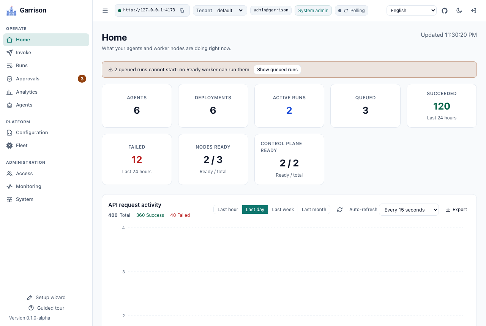

<p align="center">
  
</p>

# Garrison

> **Alpha (v0.2.0).** The REST API, MCP tools, A2A surface, database schema, settings, manifests, and SDKs can all change without notice. Do not run it against data you cannot afford to lose.

**Turn agent harnesses into managed services.** Garrison is a self-hosted, multi-tenant control plane for running Claude Code, Codex, Mux, Gemini CLI, and configurable command-line agents on your own workers. Publish reusable specialists through REST, MCP and A2A, give them the tools and credentials they need, and manage execution, approvals, results and audit history in one place.

Use it to offer coding or research agents to applications, let specialist agents delegate to one another, or build multi-stage workflows with human review. Teams can share an execution platform while keeping tenant resources, permissions, secrets and run history scoped. Harness profiles, prompts and deployments are configuration, so you can change an agent's model, tools or execution policy without changing the caller's integration.

Workers pull leased work from the control plane and report events and results over outbound connections. They never access the database. Control-plane replicas and workers scale independently; PostgreSQL supplies shared state for multi-replica deployments. Capacity depends on the workload, database and worker resources.

[Get started](#getting-started) · [Documentation](docs/README.md) · [Architecture](docs/ARCHITECTURE.md) · [Comparison](#how-garrison-compares) · [API reference](REST_API.md) · [Current scope](docs/REMAINING_PLAN_MATRIX.md)

## What it does

- **Headless harnesses, fully configurable.** A harness profile is data: the executable, an ordered list of argument templates with conditions, environment variables, files to materialize, how the prompt and system prompt are delivered, which MCP configuration format the harness reads, and which parser turns its output into events. Built-in profiles for Claude Code, Codex, Mux, and Gemini CLI ship ready to use and can be cloned and edited without a release.
- **Direct model API execution.** An optional built-in provider harness calls an operator-selected OpenAI-compatible endpoint, streams results and uses HTTP MCP tools through the same execution and approval model. See [provider API execution](docs/PROVIDER_API.md).
- **Every prompt is a template.** System prompts, task wrappers, the instructions that teach an agent how to delegate, MCP tool descriptions, A2A skill descriptions, and the harness configuration files themselves are versioned prompt templates with a live preview. Every run records the exact template versions it was compiled with.
- **Deployments bind it together.** An agent has one or more deployments. Each binds a harness profile, prompt templates, MCP servers, secrets, a workspace, placement rules, limits, and per-run parameters callers may override. Weights split traffic across deployments, so a Claude Code variant and a Mux variant of the same agent can run side by side.
- **Three ways in.** REST with server-sent events, an MCP server any MCP client can attach to, and an A2A gateway with one agent card per agent. All three use the same tenants, credentials, and RBAC.
- **Agents that call agents.** Runs configured for Garrison tools receive a short-lived, lease-fenced run token in their MCP configuration. With delegation enabled, an agent can list and invoke the agents its delegation policy allows, within depth and recursion limits, and never with more permission than the person who started the chain.
- **A person in the loop when it matters.** Turn on permission approvals for a Claude Code or Codex app-server deployment and every tool call that needs permission goes to Garrison: ordered allow, deny, and ask rules decide most of them, and the rest wait in an approvals inbox (dashboard, REST, or MCP) until someone decides, with a timeout that denies by default.
- **Pipelines with review gates.** Chain agents into ordered stages: each stage runs in its own workspace and receives the previous stage's result, structured output, and artifact references through a prompt template. A stage can stop for a person to approve it, send it back with feedback, or reject it, and retries, cancellation, and resumes are handled by the control plane on any replica. See `docs/PIPELINES.md`.
- **Triggers and notifications.** Start agents or pipelines on a cron schedule or from a signed webhook, and have Garrison POST signed notifications to your own endpoints when runs finish, fail, or wait for approval. Schedules fire once across replicas, webhooks are verified with HMAC-SHA256 and a replay window, and outbound URLs are checked against SSRF rules on every connection. See `docs/TRIGGERS.md` and `docs/NOTIFICATIONS.md`.
- **Bundles, forms, and transcripts.** Export supported tenant configuration, or an agent with its referenced resources, as a manifest bundle. Apply it to another tenant after providing its required secrets; secret values and runtime history are not exported. Agents with an input schema get a generated form in the dashboard and reject input that does not match it. Any run or conversation downloads as a Markdown or JSON transcript with configured secret redaction. See `docs/MANIFESTS.md` and `docs/TRANSCRIPTS.md`.
- **Multi-tenant from the first request.** Tenants, users, credentials, roles, permissions, scoped role assignments, effective-permission inspection, audit records, and request history, following the same authentication model as the rest of this family of projects.
- **Remote agents and tenant scheduling.** Invoke registered A2A and MCP agents through the same authorization surface. Bound queued work by cluster, tenant, and agent, and assign tenant scheduling weights. See [remote agents](docs/REMOTE_AGENTS.md) and [tenant scheduling](docs/TENANT_SCHEDULING.md).
- **Checkpoints and workspace caches.** Supported deployments can release their worker slot while awaiting a decision, store a session checkpoint in artifact storage, and resume on another compatible worker. Git mirrors and immutable prepared-workspace snapshots reduce repeated setup. See [continuation requirements and limits](docs/CONTINUATION.md).
- **Explicit effect safety and key lifecycle.** Choose a retry policy, inspect the journal of Garrison-mediated operations, rotate versioned master keys without changing external secret values, and configure credential/token expiry policies. See [effect safety](docs/effect-safety.md) and [key rotation](docs/KEY_ROTATION.md).
- **Optional persistent memory.** Agent-scoped memory uses a replaceable interface with a persistent filesystem key/value implementation. External MCP memory providers, including NotDory, remain optional. See [agent memory](docs/AGENT_MEMORY.md).
- **Operations you can explain.** Inspect why a run can or cannot be placed, track queue and execution stages, and inspect actual SQL attempts attributed to completed run scopes. Prometheus metrics, OpenTelemetry traces, logs and Grafana dashboards connect the control plane to worker activity. Scoped SQL counters are diagnostic, with shared/background work tracked separately. See [telemetry](docs/TELEMETRY.md) and [tenant scheduling](docs/TENANT_SCHEDULING.md).
- **Built to scale out.** Pull-based leasing with an atomic compare-and-set claim and a fencing epoch on every run, leader-elected maintenance through a database lease, events streamed from the database so any replica can serve any client, and Kubernetes assets for minikube, K3S, and production clusters.

## How Garrison compares

Garrison focuses on turning existing agent harnesses into governed, multi-tenant services. Its value is the operating model around execution: configurable harnesses and prompts, tenant-scoped permissions, agent-to-agent delegation, reviewed pipelines, shared REST/MCP/A2A access, and an operator console with execution evidence.

These projects overlap at different layers. Kubernetes, Agent Substrate and AX are distinct systems; AX itself is an agent orchestrator, not just a sandbox provider.

| Project or layer | Primary responsibility | How Garrison compares |
| --- | --- | --- |
| [Kubernetes](https://kubernetes.io/docs/concepts/) | Scheduling and operating containerized workloads, networking, storage and infrastructure policy. | Garrison adds agent/deployment configuration, invocation APIs, delegation, approvals and run history. Its KubernetesJob executor uses Kubernetes for per-run pods; its Process executor also works outside a cluster. |
| [Agent Substrate](https://github.com/agent-substrate/substrate) | Isolated actors on pooled workers, with gVisor/microVM sandboxing, identity/network mediation and RAM/filesystem snapshots. | Substrate addresses the sandbox lifecycle and idle-workload density. Garrison addresses agent services and workflows. These concerns can complement each other, but Garrison does not currently ship a Substrate executor. |
| [Google AX / Agent Executor](https://github.com/google/ax) | Declarative task orchestration over Agent Substrate, using Task, Workspace and Model resources, with custom runners and suspend/resume. | AX is a closer orchestration peer. Garrison emphasizes reusable named agents backed by configurable CLI harnesses, tenant-scoped application APIs, permission-bounded delegation, human review and operator-managed workflows. |
| [kagent](https://github.com/kagent-dev/kagent) | Kubernetes-native agents, harnesses, models, MCP tools and sessions managed through custom resources, with APIs, a UI and tracing. | There is real feature overlap, including CLI harness support. Garrison uses database-backed tenant resources managed through its APIs/dashboard and can run Process workers without Kubernetes; kagent centers its operating model on Kubernetes resources. |
| [E2B](https://docs.e2b.dev/) and sandbox SDKs | Creating isolated environments where agents execute code and tools, with environment templates and lifecycle APIs. | A sandbox supplies an execution environment. Garrison supplies agent configuration, authorization, dispatch, reviewed workflows and results across workers. Garrison has no native E2B executor today. |
| [LangGraph](https://docs.langchain.com/oss/python/langgraph/overview) and agent orchestration frameworks | Defining agent logic as code, including stateful graphs, persistence, streaming and human intervention. | Garrison operates harnesses and agent services rather than defining their internal reasoning graph. A framework-based agent can be packaged behind a compatible CLI, MCP or A2A interface; its internal graph semantics remain the framework's responsibility. |

**Choose Garrison when you want to operate a fleet of reusable agents through one tenant and policy model**, with configuration and review workflows supplied by the platform. Choose a framework when you need to author the agent's internal logic; choose a sandbox runtime when your main requirement is the execution boundary. Kubernetes can host the resulting platform.

The recovery mechanisms differ: Garrison checkpoints supported harness sessions and their `work/`, `home/` and `config/` files at explicit boundaries; it does not snapshot arbitrary process RAM. Its trusted Process mode and hardened Kubernetes pods do not by themselves provide Agent Substrate's gVisor/microVM boundary. Garrison remains alpha, and no like-for-like competitive throughput, density or resume-latency benchmark is claimed. See [execution and safety](#execution-and-safety) and [current validation](docs/testing/D063_VALIDATION.md).

Comparison checked against the linked upstream documentation on 2026-10-16. Feature descriptions identify each project's documented focus, not an exhaustive checklist or an assertion that another platform cannot be extended.

## Execution and safety

Use Process workers for installed harnesses, KubernetesJob execution for per-run pod isolation, or registered remote A2A/MCP agents for work hosted elsewhere. Trusted Process runs share the worker's operating-system boundary. Deployments marked Untrusted require an isolating worker; per-run egress allowlists are enforced by the Kubernetes executor. See [security](docs/SECURITY.md) and [Kubernetes execution](docs/KUBERNETES.md).

Recovery follows an explicit effect policy: AtMostOnce avoids retrying a lost running attempt, AtLeastOnce permits retries and possible duplicate effects, and Journaled resumes only when Garrison has safe checkpoint/effect evidence. Arbitrary shell commands and third-party MCP calls are outside the mediated effect journal. Durable suspension is opt-in for supported Process harnesses and releases a slot at a valid checkpoint; an arbitrary process kill is not a resumable boundary. See [effect safety](docs/effect-safety.md) and [continuation](docs/CONTINUATION.md).

## How a run works

```
 REST / MCP / A2A           Command (control plane, N replicas)              Post (worker, M replicas)
 ----------------           -----------------------------------              -------------------------
 invoke agent  ---------->  authenticate, authorize Execute on Agent
                            pick a deployment (weights), validate overrides
                            persist run as Queued                 <--------- lease (long poll)
                            claim with compare-and-set, epoch + 1
                            mint run token, compile ExecutionSpec ---------> prepare workspace, HOME, files
                                                                             MCP pre-flight
                                                                             launch harness, parse stdout
                            append events (fenced by epoch)       <--------- events in batches
                            finalize, revoke run token            <--------- complete
 result or SSE stream  <--  
```

The control plane compiles each run into a fully resolved execution spec: command line, environment, files, stdin, parser, timeouts, and the MCP servers to check before launch. The worker never reads the database and never renders a template. If a worker dies, its lease expires, the leader requeues or fails the run, and a stale worker that comes back is fenced out by its old epoch.

## Repository layout

| Path | Contents |
|---|---|
| `src/Garrison.Core` | Models, data layer (Sqlite and Postgresql), security, template renderer, invocation compiler |
| `src/Garrison.Harnesses` | Process runner, output parsers, MCP pre-flight, harness probes |
| `src/Garrison.Server` | Control plane: REST, A2A, WebSocket, MCP (Voltaic), scheduler, node protocol |
| `src/Garrison.Worker` | Worker node: registration, heartbeat, lease loop, process executor |
| `src/Garrison.FakeHarness` | Deterministic harness for tests and smoke tests |
| `src/Test.*` | Touchstone suites with console, xUnit, and NUnit runners |
| `dashboard/` | React operator console |
| `sdk/` | C#, Python, JavaScript/TypeScript, and Go SDKs |
| `docker/` | Docker Compose stack, update and factory reset scripts |
| `k8s/` | Kustomize base, components, overlays, Helm chart, scripts |
| `docs/` | Quick start, architecture, configuration, harnesses, prompts, manifests, Docker, Kubernetes, security |
| `examples/` | A multi-agent sample manifest and a script that validates an install end to end |

## Getting started

Pick the runtime you already have. Docker Compose is the quickest way to see Garrison work: one update script after cloning the repository. Kubernetes adds per-run pod isolation and cluster deployment options. Building from source is useful for development and custom installations. The supplied Compose stack has a control plane, two workers, PostgreSQL, the dashboard and observability services. Kubernetes replica counts depend on the selected overlay or chart values; a source checkout starts the processes you launch. The default seeded tenant is `default`, with administrator `admin@garrison`. There is no default password: Docker Compose and the Kubernetes scripts generate one, and the server refuses to start with public default keys or passwords outside an explicit development mode.

Harness credentials are optional at this point. Bootstrap creates three sample agent records (`claude-helper`, `codex-coder`, and `mux-helper`); their deployments are created when the corresponding credentials or endpoint are supplied. You can validate execution without a provider account using the fake-harness smoke test or the `echo` agent in the quick start.

### Docker Compose

You need Docker with Compose v2, at least 10 GB of free disk for images, build cache and telemetry retention, and 8 GB of memory allocated to Docker as a starting point. The default stack includes Prometheus, Grafana, Tempo, Loki and Alloy; larger harness workloads need more memory. The first build downloads the harnesses and build dependencies; build time depends on the host, network and cache. Subsequent builds can reuse those layers.

```bash
git clone https://github.com/jchristn/Garrison && cd Garrison/docker
./update.sh               # generates keys into .env, builds the images, starts the stack; Windows: update.bat
```

Then open http://127.0.0.1:8080 and sign in with the administrator password `update.sh` printed (it is also `GARRISON_ADMIN_PASSWORD` in `docker/.env`). Optional harness credentials (Claude, Codex, Mux) and ports go in `docker/.env` too. Default application ports on 127.0.0.1 are 8700 (REST and A2A), 8701 (MCP), 8080 (dashboard), and 5433 (PostgreSQL). Observability also publishes Grafana 3000, Prometheus 9090, Loki 3100 and Tempo 3200. Set alternate host ports in `.env` when needed. The update script prechecks application/database port conflicts; also ensure the observability ports are available. `docs/DOCKER.md` covers credentials, what a healthy stack looks like, and how to stop, update, and reset it.

### Kubernetes

Use K3S in Docker if you just want a cluster on a laptop, minikube if you already use it, or the production overlay or Helm chart for a real cluster. All of them need `kubectl`; the local options also need Docker to build the images.

```bash
k8s/scripts/deploy-k3s.sh --build         # or deploy-minikube.sh; both build the images and generate secrets
k8s/scripts/smoke-test.sh                 # invokes a fake-harness agent and checks it succeeds
k8s/scripts/port-forward.sh               # REST, MCP, and dashboard on 127.0.0.1:8700, 8701, and 8080
```

`docs/KUBERNETES.md` explains which option to choose, how to run K3S inside Docker, how to pass harness credentials, how to find the generated administrator keys, and how to scale, update, and tear down.

### From source

Hosted CI follows a smoke-first policy with dedicated compatibility/security workflows; see [CI policy](docs/CI.md) for coverage and local full-test commands.

You need the .NET 10 SDK and Node.js 22 for the dashboard. Each process runs in its own terminal, starting from the repository root:

```bash
dotnet build src/Garrison.sln
cd src/Garrison.Server && GARRISON_ALLOW_INSECURE_DEFAULTS=true dotnet run -f net10.0   # development mode; Sqlite; REST and A2A on 127.0.0.1:8700, MCP on 8701
cd src/Garrison.Worker && dotnet run -f net10.0     # one worker; a second needs its own GARRISON_WORKER_NODE_NAME and GARRISON_WORKER_HEALTH_PORT
cd dashboard && npm install && npm run dev          # dashboard; open the URL it prints
```

A worker can only run harnesses it finds on its `PATH`, so install the CLIs you want to use (`claude`, `codex`, `mux`) on the machine first. `docs/DEVELOPMENT.md` has the details, including how to put the fake harness on the `PATH`.

### Your first agents

`docs/QUICKSTART.md` picks up from any running stack. It stores your harness credentials as secrets, applies `examples/multi-agent.yaml` (agents on Claude Code, Codex, and the fake harness, one allowed to delegate to the others), adds a Mux agent through the dashboard, calls each of them over REST, MCP, and A2A, and finds the delegated run in the run tree and the numbers on the Analytics page. `examples/validate.sh` (Windows: `examples\validate.bat`) checks all of it and prints PASS or FAIL per check.

The shortest possible check, once a stack is up:

```bash
TOKEN=$(curl -s -X POST http://127.0.0.1:8700/v1.0/token -H "Content-Type: application/json" \
  -d '{"email":"admin@garrison","password":"<your administrator password>"}' | jq -r .token)
curl -s http://127.0.0.1:8700/v1.0/api/nodes -H "Authorization: Bearer $TOKEN" | jq -r '.objects[] | "\(.name) \(.status)"'
curl -s http://127.0.0.1:8700/v1.0/api/control-nodes -H "Authorization: Bearer $TOKEN" | jq -r '.objects[] | "\(.name) \(.status) leader=\(.isLeader)"'
```

Both workers should be listed as `Ready`, and so should the control plane (one `Ready` control node, the leader). Most examples in these documents use a session token like this one. Some use `x-api-key`, the platform administrator API key: `GARRISON_ADMIN_API_KEY` in `docker/.env` on Docker, a random value on Kubernetes (`docs/KUBERNETES.md` shows how to read it), and `garrisonadmin` only on a source build in development mode. Examples that show `garrisonadmin` or `password` mean your values.

The dashboard explains itself as you go. Every control carries a tooltip, each configuration page opens with a short note on how its records relate to agents and deployments, and the Analytics page charts time to first token, execution and queue time, tokens, cost, outcomes, and tool calls by agent, harness, deployment, and model.

## Harnesses

| Built-in profile | Harness | Credentials it understands | Notes |
|---|---|---|---|
| `builtin/claude-code` | Claude Code (`claude -p --output-format stream-json`) | `ANTHROPIC_API_KEY`, `CLAUDE_CODE_OAUTH_TOKEN` | Prompt on stdin, system prompt from a file, strict MCP configuration |
| `builtin/codex` | Codex (`codex exec --json`) | `OPENAI_API_KEY`, `CODEX_API_KEY`, Codex `auth.json` | Ignores user config and project instructions; MCP servers passed as `-c` overrides; text arrives one message at a time |
| `builtin/codex-app-server` | Codex (`codex app-server`, JSON-RPC over stdio) | Same as `builtin/codex` | Streams text and reasoning token by token; opt in per deployment while the Codex app-server is experimental |
| `builtin/mux` | Mux 1.3.0 (`mux --print --output-format jsonl`) | Any endpoint Mux supports, key from a secret | Endpoint, model, adapter, context window, and response token limit from deployment parameters |
| `builtin/gemini-cli` | Gemini CLI (`gemini -o stream-json`) | `GEMINI_API_KEY` | Optional in the worker image |
| `builtin/generic-jsonl` | Any CLI that prints JSON lines | Whatever you map | Field paths for text, final result, and success are configurable |
| `builtin/provider-api` | Garrison provider harness | API credential for an operator-selected compatible endpoint | Direct streaming API execution with HTTP MCP tools; no built-in shell |
| `builtin/fake` | `garrison-fake-harness` | None | Deterministic; used by tests and the cluster smoke test |

Subscription tokens such as `CLAUDE_CODE_OAUTH_TOKEN` and a Codex `auth.json` are supported because they are convenient for personal clusters. Using a personal subscription to serve other people may break the provider's terms. Use API keys for anything shared.

`docs/HARNESSES.md` covers each profile's command line, how to add a new CLI without writing code, and the quirks Garrison works around (harnesses that exit 0 after failing, MCP servers that fail authentication silently, and models that are quietly substituted).

## Protocols

| Surface | Where | Reference |
|---|---|---|
| REST and server-sent events | `http://<server>:8700/v1.0/...`, OpenAPI at `/openapi.json` | `REST_API.md` |
| WebSocket live updates | `ws://<server>:8700/v1.0/ws` | `WEBSOCKETS_API.md` |
| MCP (streamable HTTP) | `http://<server>:8701/mcp` | `MCP_API.md` |
| A2A (JSON-RPC, SSE) | `http://<server>:8700/v1.0/a2a/{tenantId}/{agentName}` | `A2A_API.md` |

Authentication is the same everywhere: a bearer session token from `POST /v1.0/token`, credential headers (`x-access-key` and `x-secret-key`), AWS-style signed requests, the administrator API key (`x-api-key`) for platform administration, and lease-fenced run tokens for authorized hosted-run tools.

## SDKs

| Language | Path | Package |
|---|---|---|
| C# | `sdk/csharp` | `Garrison.Sdk` |
| Python | `sdk/python` | `garrison_sdk` |
| JavaScript and TypeScript | `sdk/js` | `@garrison/sdk` |
| Go | `sdk/go` | `github.com/jchristn/Garrison/sdk/go` |

Each SDK has a README and a test harness. `scripts/run-sdk-harnesses.sh` starts a local server and worker and runs all four. None of the packages is published to NuGet, PyPI, or npm yet, and the Go module has no tagged release, so install them from this repository; each SDK README shows how.

## Testing

```bash
dotnet run --project src/Test.Automated -f net10.0                       # Sqlite
GARRISON_TEST_PROVIDERS=sqlite,postgresql dotnet run --project src/Test.Automated -f net10.0
dotnet test src/Test.Xunit -f net10.0
dotnet test src/Test.Nunit -f net10.0
```

The Postgresql suites expect a server at `127.0.0.1:55432` (user `postgres`, password `garrison`), which you can start with `docker run -d -p 127.0.0.1:55432:5432 -e POSTGRES_PASSWORD=garrison -e POSTGRES_DB=garrison postgres:17`. The end-to-end suites start an in-process control plane and workers on free loopback ports and run real REST, MCP, and A2A traffic through the fake harness.

## Status and roadmap

The current source implements multi-replica control planes, Kubernetes per-run isolation, conversations, approvals, pipelines, remote agents, optional quota enforcement, durable checkpoints, replaceable memory and observability. Daily quota enforcement and durable suspension are opt-in. The product remains alpha; API/SDK stability review and release work are deferred.

See [the scope matrix](docs/REMAINING_PLAN_MATRIX.md) for completed and deferred work and [the latest acceptance report](docs/testing/D063_VALIDATION.md) for the bounded local recovery, continuation and cache evidence. Larger capacity acceptance is deferred; these results do not establish a universal throughput or latency guarantee. The [plan](GARRISON_PLAN.md) retains the decisions and history.

This README describes the checkout. Build from source for these capabilities; previously published images may predate them. SDKs remain installable from the repository, with package publication skipped. No version or publication change is implied by this documentation.

## License

MIT. See `LICENSE.md`.

## Dashboard preview

These screenshots use synthetic test fixtures. They show the operator console rather than a measured production workload.




See [third-party notices](THIRD_PARTY_NOTICES.md) for application dependency licenses.
