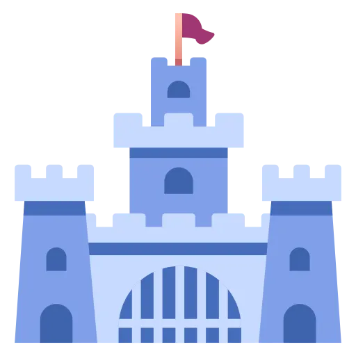

<p align="center">
  
</p>

# Garrison

> **Alpha (v0.1.0-alpha).** The REST API, MCP tools, A2A surface, database schema, settings, manifests, and SDKs can all change without notice. Do not run it against data you cannot afford to lose.

Garrison runs agent harnesses for you. Claude Code, Codex, Mux, Gemini CLI, or any command-line agent you can describe is stationed on a fleet of worker nodes, and Garrison dispatches it on demand: from REST, from any MCP client, from another A2A agent, or from one of your own agents that needs help. You decide what each agent is, which harness runs it, what every prompt says, which MCP servers and credentials it gets, and where it is allowed to run. Garrison does the rest, and it does it across as many control-plane and worker replicas as you care to run.

The control plane never reaches out to a worker. Workers pull work by lease, run the harness headless in its own workspace, stream normalized events back, and report a result. That one rule is what lets the two halves scale independently: more control-plane replicas buy you API and scheduling capacity, more workers buy you execution capacity, and neither has to know how many of the other exist.

## What it does

- **Headless harnesses, fully configurable.** A harness profile is data: the executable, an ordered list of argument templates with conditions, environment variables, files to materialize, how the prompt and system prompt are delivered, which MCP configuration format the harness reads, and which parser turns its output into events. Built-in profiles for Claude Code, Codex, Mux, and Gemini CLI ship ready to use and can be cloned and edited without a release.
- **Every prompt is a template.** System prompts, task wrappers, the instructions that teach an agent how to delegate, MCP tool descriptions, A2A skill descriptions, and the harness configuration files themselves are versioned prompt templates with a live preview. Every run records the exact template versions it was compiled with.
- **Deployments bind it together.** An agent has one or more deployments. Each binds a harness profile, prompt templates, MCP servers, secrets, a workspace, placement rules, limits, and per-run parameters callers may override. Weights split traffic across deployments, so a Claude Code variant and a Mux variant of the same agent can run side by side.
- **Three ways in.** REST with server-sent events, an MCP server any MCP client can attach to, and an A2A gateway with one agent card per agent. All three use the same tenants, credentials, and RBAC.
- **Agents that call agents.** Each run receives a short-lived run token in its MCP configuration. With it, an agent can list and invoke the agents its deployment allows, within depth and recursion limits, and never with more permission than the person who started the chain.
- **A person in the loop when it matters.** Turn on permission approvals for a Claude Code or Codex app-server deployment and every tool call that needs permission goes to Garrison: ordered allow, deny, and ask rules decide most of them, and the rest wait in an approvals inbox (dashboard, REST, or MCP) until someone decides, with a timeout that denies by default.
- **Pipelines with review gates.** Chain agents into ordered stages: each stage runs in its own workspace and receives the previous stage's result, structured output, and artifact references through a prompt template. A stage can stop for a person to approve it, send it back with feedback, or reject it, and retries, cancellation, and resumes are handled by the control plane on any replica. See `docs/PIPELINES.md`.
- **Triggers and notifications.** Start agents or pipelines on a cron schedule or from a signed webhook, and have Garrison POST signed notifications to your own endpoints when runs finish, fail, or wait for approval. Schedules fire once across replicas, webhooks are verified with HMAC-SHA256 and a replay window, and outbound URLs are checked against SSRF rules on every connection. See `docs/TRIGGERS.md` and `docs/NOTIFICATIONS.md`.
- **Multi-tenant from the first request.** Tenants, users, credentials, roles, permissions, scoped role assignments, effective-permission inspection, audit records, and request history, following the same authentication model as the rest of this family of projects.
- **Built to scale out.** Pull-based leasing with an atomic compare-and-set claim and a fencing epoch on every run, leader-elected maintenance through a database lease, events streamed from the database so any replica can serve any client, and Kubernetes assets for minikube, K3S, and production clusters.

## How a run works

```
 REST / MCP / A2A           Command (control plane, N replicas)              Post (worker, M replicas)
 ----------------           -----------------------------------              -------------------------
 invoke agent  ---------->  authenticate, authorize Execute on Agent
                            pick a deployment (weights), validate overrides
                            persist run as Queued                 <--------- lease (long poll)
                            claim with compare-and-set, epoch + 1
                            mint run token, compile ExecutionSpec ---------> prepare workspace, HOME, files
                                                                             MCP pre-flight
                                                                             launch harness, parse stdout
                            append events (fenced by epoch)       <--------- events in batches
                            finalize, revoke run token            <--------- complete
 result or SSE stream  <--  
```

The control plane compiles each run into a fully resolved execution spec: command line, environment, files, stdin, parser, timeouts, and the MCP servers to check before launch. The worker never reads the database and never renders a template. If a worker dies, its lease expires, the leader requeues or fails the run, and a stale worker that comes back is fenced out by its old epoch.

## Repository layout

| Path | Contents |
|---|---|
| `src/Garrison.Core` | Models, data layer (Sqlite and Postgresql), security, template renderer, invocation compiler |
| `src/Garrison.Harnesses` | Process runner, output parsers, MCP pre-flight, harness probes |
| `src/Garrison.Server` | Control plane: REST, A2A, WebSocket, MCP (Voltaic), scheduler, node protocol |
| `src/Garrison.Worker` | Worker node: registration, heartbeat, lease loop, process executor |
| `src/Garrison.FakeHarness` | Deterministic harness for tests and smoke tests |
| `src/Test.*` | Touchstone suites with console, xUnit, and NUnit runners |
| `dashboard/` | React operator console |
| `sdk/` | C#, Python, JavaScript/TypeScript, and Go SDKs |
| `docker/` | Docker Compose stack, update and factory reset scripts |
| `k8s/` | Kustomize base, components, overlays, Helm chart, scripts |
| `docs/` | Quick start, architecture, configuration, harnesses, prompts, manifests, Docker, Kubernetes, security |
| `examples/` | A multi-agent sample manifest and a script that validates an install end to end |

## Getting started

Pick the runtime you already have. Docker Compose is the quickest way to see Garrison work: one command, nothing to install beyond Docker. Kubernetes is where Garrison is meant to run for real. Building from source is for working on Garrison itself. Every route ends in the same place: a control plane, two workers, the dashboard, and a tenant called `default` you sign in to as `admin@garrison` with password `password`. Change that password before anyone else can reach the stack.

Harness credentials are optional at this point. Without them the fake harness still runs end to end; with them, the stack creates three sample agents (`claude-helper` on Claude Code, `codex-coder` on Codex, and `mux-helper` on Mux) the first time it starts.

### Docker Compose

You need Docker with Compose v2, about 5 GB of free disk for the images and build cache, and 4 GB of memory for Docker. The first build downloads a lot (Node.js, Claude Code, Codex, Mux and its NuGet packages, three .NET base images), so it takes anywhere from about 8 minutes on a fast connection to 20 on a slow one; later builds take seconds.

```bash
git clone https://github.com/jchristn/Garrison && cd Garrison/docker
cp .env.example .env      # ports, keys, and optional harness credentials (Claude, Codex, Mux)
./update.sh               # builds the images and starts the stack; Windows: update.bat
```

Then open http://127.0.0.1:8080. The stack uses ports 8700 (REST and A2A), 8701 (MCP), 8080 (dashboard), and 5433 (Postgres) on 127.0.0.1. If any of them is taken, `update.sh` says which before it builds anything; set other ports in `.env` and run it again. `docs/DOCKER.md` covers credentials, what a healthy stack looks like, and how to stop, update, and reset it.

### Kubernetes

Use K3S in Docker if you just want a cluster on a laptop, minikube if you already use it, or the production overlay or Helm chart for a real cluster. All of them need `kubectl`; the local options also need Docker to build the images.

```bash
k8s/scripts/deploy-k3s.sh --build         # or deploy-minikube.sh; both build the images and generate secrets
k8s/scripts/smoke-test.sh                 # invokes a fake-harness agent and checks it succeeds
k8s/scripts/port-forward.sh               # REST, MCP, and dashboard on 127.0.0.1:8700, 8701, and 8080
```

`docs/KUBERNETES.md` explains which option to choose, how to run K3S inside Docker, how to pass harness credentials, how to find the generated administrator keys, and how to scale, update, and tear down.

### From source

GitHub Actions uses push-only, path-filtered smoke checks to conserve minutes; see [CI policy](docs/CI.md) for coverage and local full-test commands.

You need the .NET 10 SDK, and Node.js for the dashboard (CI uses Node 22). Each process runs in its own terminal, starting from the repository root:

```bash
dotnet build src/Garrison.sln
cd src/Garrison.Server && dotnet run -f net10.0     # Sqlite; REST and A2A on 127.0.0.1:8700, MCP on 8701
cd src/Garrison.Worker && dotnet run -f net10.0     # one worker; a second needs its own GARRISON_WORKER_NODE_NAME and GARRISON_WORKER_HEALTH_PORT
cd dashboard && npm install && npm run dev          # dashboard; open the URL it prints
```

A worker can only run harnesses it finds on its `PATH`, so install the CLIs you want to use (`claude`, `codex`, `mux`) on the machine first. `docs/DEVELOPMENT.md` has the details, including how to put the fake harness on the `PATH`.

### Your first agents

`docs/QUICKSTART.md` picks up from any running stack. It stores your harness credentials as secrets, applies `examples/multi-agent.yaml` (agents on Claude Code, Codex, and the fake harness, one allowed to delegate to the others), adds a Mux agent through the dashboard, calls each of them over REST, MCP, and A2A, and finds the delegated run in the run tree and the numbers on the Analytics page. `examples/validate.sh` (Windows: `examples\validate.bat`) checks all of it and prints PASS or FAIL per check.

The shortest possible check, once a stack is up:

```bash
TOKEN=$(curl -s -X POST http://127.0.0.1:8700/v1.0/token -H "Content-Type: application/json" \
  -d '{"email":"admin@garrison","password":"password"}' | jq -r .token)
curl -s http://127.0.0.1:8700/v1.0/api/nodes -H "Authorization: Bearer $TOKEN" | jq -r '.objects[] | "\(.name) \(.status)"'
curl -s http://127.0.0.1:8700/v1.0/api/control-nodes -H "Authorization: Bearer $TOKEN" | jq -r '.objects[] | "\(.name) \(.status) leader=\(.isLeader)"'
```

Both workers should be listed as `Ready`, and so should the control plane (one `Ready` control node, the leader). Most examples in these documents use a session token like this one. Some use `x-api-key`, the platform administrator API key: `garrisonadmin` on a source build or Docker unless you set `GARRISON_ADMIN_API_KEY`, and a random value on Kubernetes (`docs/KUBERNETES.md` shows how to read it).

The dashboard explains itself as you go. Every control carries a tooltip, each configuration page opens with a short note on how its records relate to agents and deployments, and the Analytics page charts time to first token, execution and queue time, tokens, cost, outcomes, and tool calls by agent, harness, deployment, and model.

## Harnesses

| Built-in profile | Harness | Credentials it understands | Notes |
|---|---|---|---|
| `builtin/claude-code` | Claude Code (`claude -p --output-format stream-json`) | `ANTHROPIC_API_KEY`, `CLAUDE_CODE_OAUTH_TOKEN` | Prompt on stdin, system prompt from a file, strict MCP configuration |
| `builtin/codex` | Codex (`codex exec --json`) | `OPENAI_API_KEY`, `CODEX_API_KEY`, Codex `auth.json` | Ignores user config and project instructions; MCP servers passed as `-c` overrides; text arrives one message at a time |
| `builtin/codex-app-server` | Codex (`codex app-server`, JSON-RPC over stdio) | Same as `builtin/codex` | Streams text and reasoning token by token; opt in per deployment while the Codex app-server is experimental |
| `builtin/mux` | Mux 1.3.0 (`mux --print --output-format jsonl`) | Any endpoint Mux supports, key from a secret | Endpoint, model, adapter, context window, and response token limit from deployment parameters |
| `builtin/gemini-cli` | Gemini CLI (`gemini -o stream-json`) | `GEMINI_API_KEY` | Optional in the worker image |
| `builtin/generic-jsonl` | Any CLI that prints JSON lines | Whatever you map | Field paths for text, final result, and success are configurable |
| `builtin/fake` | `garrison-fake-harness` | None | Deterministic; used by tests and the cluster smoke test |

Subscription tokens such as `CLAUDE_CODE_OAUTH_TOKEN` and a Codex `auth.json` are supported because they are convenient for personal clusters. Using a personal subscription to serve other people may break the provider's terms. Use API keys for anything shared.

`docs/HARNESSES.md` covers each profile's command line, how to add a new CLI without writing code, and the quirks Garrison works around (harnesses that exit 0 after failing, MCP servers that fail authentication silently, and models that are quietly substituted).

## Protocols

| Surface | Where | Reference |
|---|---|---|
| REST and server-sent events | `http://<server>:8700/v1.0/...`, OpenAPI at `/openapi.json` | `REST_API.md` |
| WebSocket live updates | `ws://<server>:8700/v1.0/ws` | `WEBSOCKETS_API.md` |
| MCP (streamable HTTP) | `http://<server>:8701/mcp` | `MCP_API.md` |
| A2A (JSON-RPC, SSE) | `http://<server>:8700/v1.0/a2a/{tenantId}/{agentName}` | `A2A_API.md` |

Authentication is the same everywhere: a bearer session token from `POST /v1.0/token`, credential headers (`x-access-key` and `x-secret-key`), AWS-style signed requests, the administrator API key (`x-api-key`) for platform administration, and run tokens for agents delegating to agents.

## SDKs

| Language | Path | Package |
|---|---|---|
| C# | `sdk/csharp` | `Garrison.Sdk` |
| Python | `sdk/python` | `garrison_sdk` |
| JavaScript and TypeScript | `sdk/js` | `@garrison/sdk` |
| Go | `sdk/go` | `github.com/jchristn/Garrison/sdk/go` |

Each SDK has a README and a test harness. `scripts/run-sdk-harnesses.sh` starts a local server and worker and runs all four. None of the packages is published to NuGet, PyPI, or npm yet, and the Go module has no tagged release, so install them from this repository; each SDK README shows how.

## Testing

```bash
dotnet run --project src/Test.Automated -f net10.0                       # Sqlite
GARRISON_TEST_PROVIDERS=sqlite,postgresql dotnet run --project src/Test.Automated -f net10.0
dotnet test src/Test.Xunit -f net10.0
dotnet test src/Test.Nunit -f net10.0
```

The Postgresql suites expect a server at `127.0.0.1:55432` (user `postgres`, password `garrison`), which you can start with `docker run -d -p 127.0.0.1:55432:5432 -e POSTGRES_PASSWORD=garrison -e POSTGRES_DB=garrison postgres:17`. The end-to-end suites start an in-process control plane and workers on free loopback ports and run real REST, MCP, and A2A traffic through the fake harness.

## Status and roadmap

`GARRISON_PLAN.md` is the build plan and progress tracker. The MVP milestone is one control node, two worker nodes, working Claude Code, Codex, and Mux agents, the dashboard, the SDKs, tests, Postman, and documentation. After that come control-plane high availability, a pod-per-run executor for stronger isolation, conversations and permission approvals, remote agents, budgets, and benchmarks.

## License

MIT. See `LICENSE.md`.
