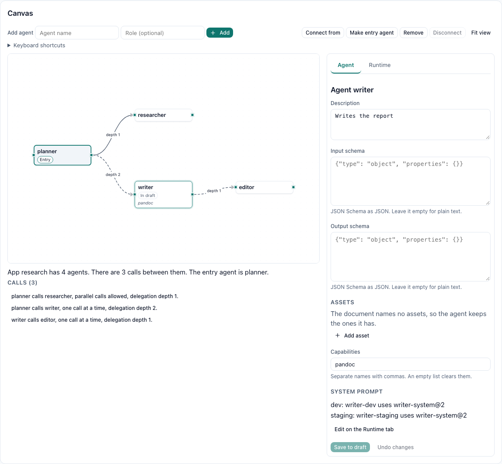
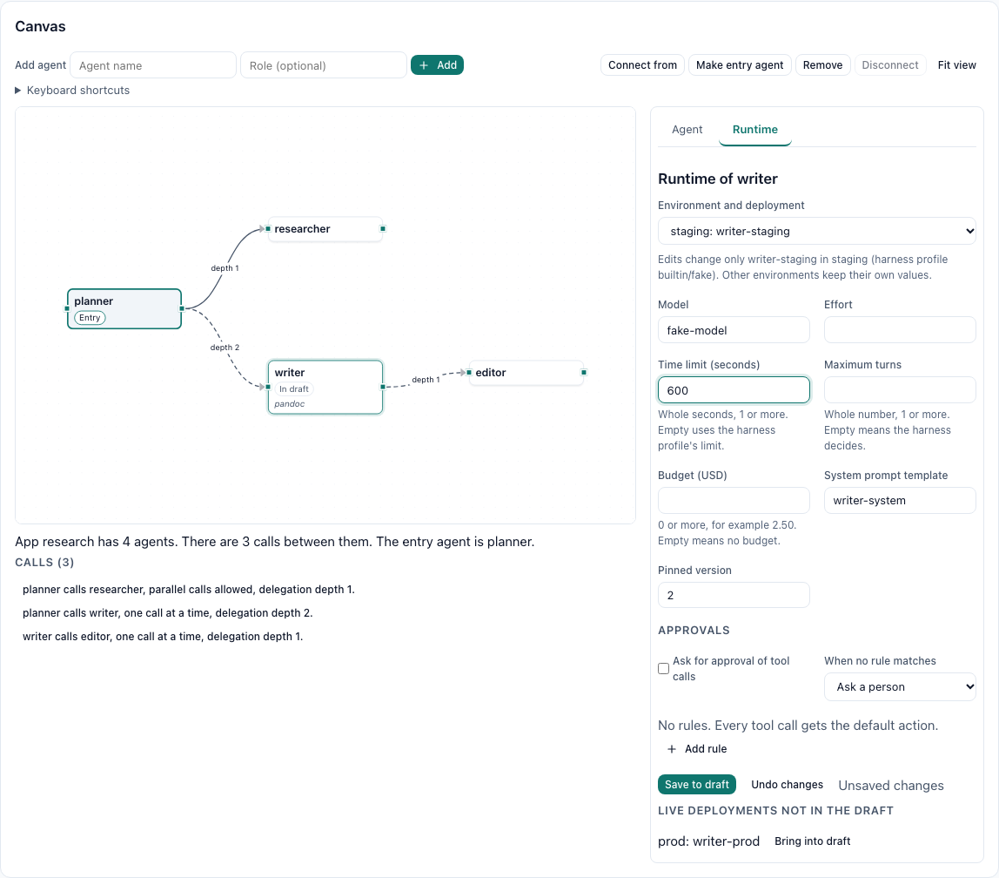
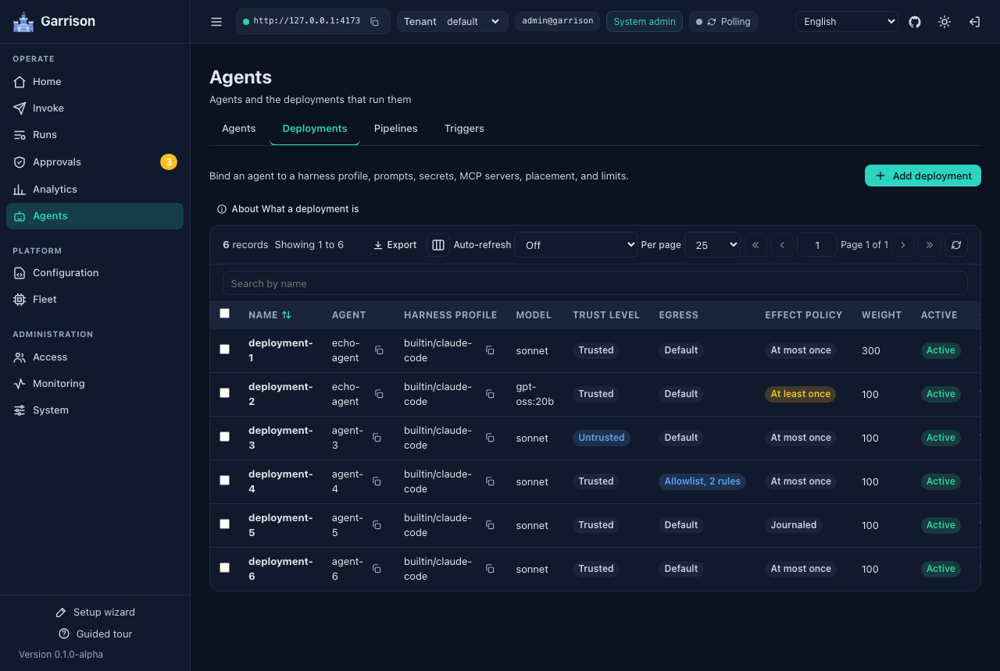

<p align="center">
  
</p>

# Garrison

> **Alpha (v0.2.0).** A 0.x version means alpha: the REST API, MCP tools, A2A surface, database schema, settings, manifests, and SDKs can all change without notice. Do not run it against data you cannot afford to lose.

**Build, deploy, and run agentic apps on the agent harnesses you already use.** Garrison is a self-hosted, multi-tenant platform for agentic applications. Underneath is a horizontally elastic runtime that turns Claude Code, Codex, Gemini CLI, Mux, opencode, pi, provider APIs, and any command-line agent into managed services on workers you operate. On top of it, Garrison Agent Studio is where those agents become apps: an architect agent drafts them with you, you review the diff and try the draft in a playground, a person approves the change, and the app goes live at its own URL with its own chat UI.

Both halves share one model. An app built in the studio is made of the same agents, deployments, prompt templates, and permissions you would configure by hand, so nothing the studio produces is a black box, and anything you build by hand can be opened in the studio later. Every agent stays reachable over REST, MCP, and A2A, and every run, studio runs included, lands in the same run history, transcripts, and telemetry.

Workers pull leased work from the control plane over outbound connections and never touch the database. Control-plane replicas and workers scale independently, PostgreSQL holds shared state for multi-replica installs, and Kubernetes assets cover minikube, K3S, and production clusters.

[Website](https://usegarrison.ai) · [Studio quickstart](#studio-quickstart) · [Documentation](docs/README.md) · [Architecture](docs/ARCHITECTURE.md) · [Comparison](#how-garrison-compares) · [API reference](REST_API.md) · [Changelog](CHANGELOG.md)

## Build, test, deploy, run, operate, observe

Garrison covers an agentic app from the first sketch to the dashboards you watch once it has users.

| Stage | What you get | Read |
|---|---|---|
| Build | The agent architect, an agent that designs apps with you in a studio draft. Built-in and cloneable architect prompts. Versioned agent assets (skills, reference files, document templates). A capability catalog that puts Garrison agents, MCP tools, and host tools side by side | [Studio](docs/STUDIO.md), [architect](docs/ARCHITECT.md), [assets](docs/ASSETS.md), [capabilities](docs/CAPABILITIES.md) |
| Test | A playground that runs a draft as an unpublished revision, and a compile preview that shows the exact command line, placed asset paths, and file space mount for a revision and environment | [Studio playground](docs/STUDIO.md#playground) |
| Deploy | A draft applies only through a `DraftApply` approval a person decides. Applying publishes agent revisions and deploys to `dev`; promotion moves a whole app to `staging` and `prod`, and rollback restores the previous pins | [Studio](docs/STUDIO.md#applying-a-draft), [revisions and environments](docs/REVISIONS.md), [apps](docs/APPS.md#app-revisions-and-promotion) |
| Run and scale | Pull-based leasing with fencing, Process and KubernetesJob executors, durable continuation, parallel fan-out with gather, and conversation file spaces shared by every agent in a delegation tree | [Architecture](docs/ARCHITECTURE.md), [fan-out](docs/FAN_OUT.md), [file spaces](docs/FILE_SPACES.md), [scaling](docs/SCALING.md) |
| Operate and manage | Agentic apps with a branded end-user chat UI, a file panel, and a shareable URL; RBAC with tenant and resource scopes, quotas, triggers, notifications, and approvals | [Apps](docs/APPS.md), [app UI](docs/APP_UI.md), [security](docs/SECURITY.md) |
| Observe | Runs, run trees with fan-out groups, transcripts, analytics, Prometheus metrics, OpenTelemetry traces, and Grafana dashboards | [Telemetry](docs/TELEMETRY.md), [transcripts](docs/TRANSCRIPTS.md) |

## Agent Studio

The studio works on **drafts**. A draft is a set of manifest documents (agents, deployments, prompt templates, assets, an app and its edges) that a person, the agent architect, or both edit together. Every change names the draft version it read, so two editors never overwrite each other silently. The studio shows the draft as a diff against live configuration and validates it with a manifest dry run. Nothing goes live until someone asks to apply it and a person with the right permissions approves.

The **agent architect** is a protected agent seeded in every tenant. You give it a deployment on the harness and model you want, and it builds drafts through studio MCP tools. Its deployment carries `managementAccess: Drafts`: its runs may edit only the drafts of the person talking to it, always within that person's permissions, and can never apply a draft, decide an approval, delete live resources, or read secrets. Garrison ships two architect prompts, `builtin/agent-architect` and the step-by-step `builtin/agent-architect-guided`. Clone one, edit it freely, and select it; the change applies on the architect's next turn ([docs/ARCHITECT.md](docs/ARCHITECT.md)).

An **agentic app** groups agents behind one entry agent. Its edges become each member's delegation policy, and it gets its own URL at `/apps/{slug}/`, branding, and sign-in for tenant users, users holding the `AppUser` role, or anonymous visitors when you allow them. End users chat, watch answers stream, and download the files agents wrote, without ever seeing the operator dashboard ([docs/APPS.md](docs/APPS.md), [docs/APP_UI.md](docs/APP_UI.md)).

In the dashboard, Agents > Agents > Agent wizard walks you from a description of what you need to approved agents running in dev: model access and credentials, the architect chat, review, approval, and a first conversation. A draft's full workspace (Advanced in the wizard) has the architect chat, the canvas, the diff and approval, the playground, compile preview, promotion and rollback, and the architect prompt editor. Architects are reusable across drafts: Agents > Architects lists them and creates, edits, and deletes them, and the setup wizard can create the first one for you. Everything in the studio is also reachable over REST, MCP, and the four SDKs; the quickstart below uses `curl` so you can see each step.

## Studio quickstart

This path uses the fake harness, so it needs no model credentials. Start the Compose stack from a fresh clone (the first build downloads harnesses and takes a while; later runs reuse the layers):

```bash
git clone https://github.com/jchristn/Garrison && cd Garrison/docker
./update.sh               # generates keys into .env, builds the images, starts the stack; Windows: update.bat
cd ..
```

Sign in from the repository root:

```bash
API=http://127.0.0.1:8700/v1.0/api/tenants/default
GARRISON_ADMIN_PASSWORD=$(grep -E '^GARRISON_ADMIN_PASSWORD=' docker/.env | cut -d= -f2-)
TOKEN=$(jq -n --arg p "$GARRISON_ADMIN_PASSWORD" '{email:"admin@garrison",password:$p,tenantId:"default"}' |
  curl -s -X POST http://127.0.0.1:8700/v1.0/token -H "Content-Type: application/json" --data-binary @- | jq -r .token)
```

Draft an agent, its `dev` deployment, and an app with that agent as its entry. Each change names the draft version you read:

```bash
D=$API/studio/drafts
DRAFT=$(curl -s -X POST $D -H "Authorization: Bearer $TOKEN" -H "Content-Type: application/json" -d '{"title":"Help desk"}' | jq -r .id)
put() { curl -s -X PUT "$D/$DRAFT/items/$1/$2" -H "Authorization: Bearer $TOKEN" -H "Content-Type: application/json" \
  -d "$(jq -n --argjson v "$3" --arg doc "$4" '{version:$v,document:$doc}')" | jq -r .version; }
V=$(put Agent desk-entry 1 $'apiVersion: garrison/v1\nkind: Agent\nmetadata:\n  name: desk-entry\n  description: Answers people.\nspec:\n  displayName: Help desk\n')
V=$(put Deployment desk-entry-dev $V $'apiVersion: garrison/v1\nkind: Deployment\nmetadata:\n  name: desk-entry-dev\nspec:\n  agent: desk-entry\n  harnessProfile: builtin/fake\n  environment: dev\n')
V=$(put AgenticApp desk $V $'apiVersion: garrison/v1\nkind: AgenticApp\nmetadata:\n  name: desk\nspec:\n  entry: desk-entry\n  members:\n    - { agent: desk-entry }\n  environments:\n    - { environment: dev, deployment: desk-entry-dev }\n  liveEnvironment: dev\n  authMode: Anonymous\n  anonymousEnabled: true\n')
curl -s $D/$DRAFT/diff -H "Authorization: Bearer $TOKEN" | jq -c '.items[] | {kind, name, change}'
```

The diff lists three `Create` items. Ask for approval and approve it yourself as the administrator; approving applies the draft and deploys it to `dev`:

```bash
APPROVAL=$(curl -s -X POST $D/$DRAFT/request-apply -H "Authorization: Bearer $TOKEN" -H "Content-Type: application/json" -d "{\"version\":$V}" | jq -r .id)
curl -s -X POST $API/approvals/$APPROVAL/decide -H "Authorization: Bearer $TOKEN" -H "Content-Type: application/json" -d '{"decision":"Allow"}' | jq -r .status
```

Open http://127.0.0.1:8080/apps/desk/ and send a message; the fake harness echoes it back. From here, [docs/QUICKSTART.md](docs/QUICKSTART.md#9-build-an-app-in-the-studio) shows the playground and promotion, [docs/ARCHITECT.md](docs/ARCHITECT.md) shows how to let the architect write drafts with you, and [examples/agentic-apps](examples/agentic-apps/README.md) has three complete apps to apply: a support triage desk, a document converter, and a research app that fans out to two researchers and hands back a PDF.

## The runtime

The studio is only as useful as what runs underneath it. These are the pieces you get whether or not you ever open a draft:

- **Harnesses are data.** A harness profile describes the executable, ordered argument templates with conditions, environment variables, files to materialize, how prompt and system prompt are delivered, the MCP configuration format, and which parser turns output into events. Built-in profiles ship for every harness in the table below and can be cloned and edited without a release.
- **Every prompt is a template.** System prompts, task wrappers, delegation and fan-out instructions, MCP tool and A2A skill descriptions, and the harness configuration files are versioned prompt templates with a live preview. Every run records the exact versions it rendered.
- **Revisions and deployments.** Agents keep immutable revisions; deployments bind a revision (or follow the latest published one) to a harness profile, prompts, MCP servers, secrets, a workspace, an environment label, placement rules, and limits. Weights split traffic across deployments.
- **Three ways in.** REST with server-sent events, an MCP server any MCP client can attach to, and an A2A gateway with one agent card per agent, all on the same tenants, credentials, and RBAC. Apps add a fourth, narrower door: the app gateway at `/v1.0/apps/{slug}/`, which accepts only app sessions.
- **Agents that call agents.** Runs get a short-lived, lease-fenced run token. With delegation on, an agent can invoke the agents its allow list names, one at a time or several at once with fan-out and gather, within depth and recursion limits and never with more permission than the person who started the chain.
- **Files that outlive a turn.** A conversation file space is shared by every turn and every delegated run of a conversation, synced into the workspace at run start and written back at run end, with optimistic per-path versions so parallel writers never lose a file.
- **A person in the loop.** Permission approvals for Claude Code and Codex app-server tool calls and `DraftApply` approvals for studio changes share one approvals inbox, with ordered allow, deny, and ask rules and a timeout that denies by default. Pipelines add review gates between stages.
- **Triggers, notifications, bundles.** Cron and signed-webhook triggers, signed outbound notifications, manifest bundles that export and re-apply across tenants, input forms from schemas, and Markdown or JSON transcripts with secret redaction.
- **Multi-tenant from the first request.** Tenants, users, credentials, roles, scoped assignments, effective-permission inspection, audit, and request history.
- **Operations you can explain.** Placement explanations for queued runs, blocked-run reasons, scoped SQL diagnostics, Prometheus metrics, OpenTelemetry traces, logs, and Grafana dashboards.
- **Built to scale out.** Atomic compare-and-set claims with a fencing epoch on every run, leader-elected maintenance, events streamed from the database so any replica can serve any client, opt-in durable checkpoints that release a worker slot during long waits, and workspace caches.

## How Garrison compares

Garrison focuses on turning existing agent harnesses into governed, multi-tenant services. Its value is the operating model around execution: configurable harnesses and prompts, tenant-scoped permissions, agent-to-agent delegation, reviewed pipelines, shared REST/MCP/A2A access, and an operator console with execution evidence.

These projects overlap at different layers. Kubernetes, Agent Substrate and AX are distinct systems; AX itself is an agent orchestrator, not just a sandbox provider.

| Project or layer | Primary responsibility | How Garrison compares |
| --- | --- | --- |
| [Kubernetes](https://kubernetes.io/docs/concepts/) | Scheduling and operating containerized workloads, networking, storage and infrastructure policy. | Garrison adds agent/deployment configuration, invocation APIs, delegation, approvals and run history. Its KubernetesJob executor uses Kubernetes for per-run pods; its Process executor also works outside a cluster. |
| [Agent Substrate](https://github.com/agent-substrate/substrate) | Isolated actors on pooled workers, with gVisor/microVM sandboxing, identity/network mediation and RAM/filesystem snapshots. | Substrate addresses the sandbox lifecycle and idle-workload density. Garrison addresses agent services and workflows. These concerns can complement each other, but Garrison does not currently ship a Substrate executor. |
| [Google AX / Agent Executor](https://github.com/google/ax) | Declarative task orchestration over Agent Substrate, using Task, Workspace and Model resources, with custom runners and suspend/resume. | AX is a closer orchestration peer. Garrison emphasizes reusable named agents backed by configurable CLI harnesses, tenant-scoped application APIs, permission-bounded delegation, human review and operator-managed workflows. |
| [kagent](https://github.com/kagent-dev/kagent) | Kubernetes-native agents, harnesses, models, MCP tools and sessions managed through custom resources, with APIs, a UI and tracing. | There is real feature overlap, including CLI harness support. Garrison uses database-backed tenant resources managed through its APIs/dashboard and can run Process workers without Kubernetes; kagent centers its operating model on Kubernetes resources. |
| [E2B](https://docs.e2b.dev/) and sandbox SDKs | Creating isolated environments where agents execute code and tools, with environment templates and lifecycle APIs. | A sandbox supplies an execution environment. Garrison supplies agent configuration, authorization, dispatch, reviewed workflows and results across workers. Garrison has no native E2B executor today. |
| [LangGraph](https://docs.langchain.com/oss/python/langgraph/overview) and agent orchestration frameworks | Defining agent logic as code, including stateful graphs, persistence, streaming and human intervention. | Garrison operates harnesses and agent services rather than defining their internal reasoning graph. A framework-based agent can be packaged behind a compatible CLI, MCP or A2A interface; its internal graph semantics remain the framework's responsibility. |

**Choose Garrison when you want to build and operate a fleet of reusable agents, and the apps made from them, through one tenant and policy model**, with design, review, and promotion workflows supplied by the platform. Choose a framework when you need to author the agent's internal logic; choose a sandbox runtime when your main requirement is the execution boundary. Kubernetes can host the resulting platform.

The recovery mechanisms differ: Garrison checkpoints supported harness sessions and their `work/`, `home/` and `config/` files at explicit boundaries; it does not snapshot arbitrary process RAM. Its trusted Process mode and hardened Kubernetes pods do not by themselves provide Agent Substrate's gVisor/microVM boundary. Garrison remains alpha, and no like-for-like competitive throughput, density or resume-latency benchmark is claimed. See [execution and safety](#execution-and-safety) and [current validation](docs/testing/D063_VALIDATION.md).

Comparison checked against the linked upstream documentation on 2026-10-16. Feature descriptions identify each project's documented focus, not an exhaustive checklist or an assertion that another platform cannot be extended.

## Execution and safety

Use Process workers for installed harnesses, KubernetesJob execution for per-run pod isolation, or registered remote A2A/MCP agents for work hosted elsewhere. Trusted Process runs share the worker's operating-system boundary. Deployments marked Untrusted require an isolating worker; per-run egress allowlists are enforced by the Kubernetes executor. See [security](docs/SECURITY.md) and [Kubernetes execution](docs/KUBERNETES.md).

Recovery follows an explicit effect policy: AtMostOnce avoids retrying a lost running attempt, AtLeastOnce permits retries and possible duplicate effects, and Journaled resumes only when Garrison has safe checkpoint/effect evidence. Arbitrary shell commands and third-party MCP calls are outside the mediated effect journal. Durable suspension is opt-in for supported Process harnesses and releases a slot at a valid checkpoint; an arbitrary process kill is not a resumable boundary. See [effect safety](docs/effect-safety.md) and [continuation](docs/CONTINUATION.md).

## How a run works

```
 REST / MCP / A2A           Command (control plane, N replicas)              Post (worker, M replicas)
 ----------------           -----------------------------------              -------------------------
 invoke agent  ---------->  authenticate, authorize Execute on Agent
                            pick a deployment (weights), validate overrides
                            persist run as Queued                 <--------- lease (long poll)
                            claim with compare-and-set, epoch + 1
                            mint run token, compile ExecutionSpec ---------> prepare workspace, HOME, files
                                                                             MCP pre-flight
                                                                             launch harness, parse stdout
                            append events (fenced by epoch)       <--------- events in batches
                            finalize, revoke run token            <--------- complete
 result or SSE stream  <--  
```

The control plane compiles each run into a fully resolved execution spec: command line, environment, files, stdin, parser, timeouts, and the MCP servers to check before launch. The worker never reads the database and never renders a template. If a worker dies, its lease expires, the leader requeues or fails the run, and a stale worker that comes back is fenced out by its old epoch.

## Repository layout

| Path | Contents |
|---|---|
| `src/Garrison.Core` | Models, data layer (Sqlite and Postgresql), security, template renderer, invocation compiler, manifests, studio and revision services |
| `src/Garrison.Harnesses` | Process runner, output parsers, MCP pre-flight, harness probes |
| `src/Garrison.Server` | Control plane: REST, A2A, WebSocket, MCP (Voltaic), app gateway, scheduler, node protocol |
| `src/Garrison.Worker` | Worker node: registration, heartbeat, lease loop, Process and KubernetesJob executors, asset and file space sync |
| `src/Garrison.FakeHarness` | Deterministic harness for tests, smoke tests, and the examples |
| `src/Test.*` | Touchstone suites with console, xUnit, and NUnit runners |
| `dashboard/` | React operator console |
| `app-ui/` | React end-user chat UI for agentic apps, served by the dashboard image under `/apps/` |
| `sdk/` | C#, Python, JavaScript/TypeScript, and Go SDKs |
| `docker/` | Docker Compose stack, update and factory reset scripts |
| `k8s/` | Kustomize base, components, overlays, Helm chart, scripts |
| `docs/` | Guides and references; [docs/README.md](docs/README.md) is the index |
| `examples/` | A multi-agent manifest, a fan-out manifest, the [example agentic apps](examples/agentic-apps/README.md), and a script that validates an install end to end |

## Getting started

Pick the runtime you already have. Docker Compose is the quickest way to see Garrison work: one update script after cloning the repository, as in the [studio quickstart](#studio-quickstart). Kubernetes adds per-run pod isolation and cluster deployment options. Building from source is useful for development and custom installations. The supplied Compose stack has a control plane, two workers, PostgreSQL, the dashboard and observability services. Kubernetes replica counts depend on the selected overlay or chart values; a source checkout starts the processes you launch. The default seeded tenant is `default`, with administrator `admin@garrison`. There is no default password: Docker Compose and the Kubernetes scripts generate one, and the server refuses to start with public default keys or passwords outside an explicit development mode.

Harness credentials are optional at this point. Bootstrap creates three sample agent records (`claude-helper`, `codex-coder`, and `mux-helper`); their deployments are created when the corresponding credentials or endpoint are supplied. You can validate execution without a provider account using the fake-harness smoke test or the `echo` agent in the quick start.

### Docker Compose

You need Docker with Compose v2, at least 10 GB of free disk for images, build cache and telemetry retention, and 8 GB of memory allocated to Docker as a starting point. The default stack includes Prometheus, Grafana, Tempo, Loki and Alloy; larger harness workloads need more memory. The first build downloads the harnesses and build dependencies; build time depends on the host, network and cache. Subsequent builds can reuse those layers.

```bash
git clone https://github.com/jchristn/Garrison && cd Garrison/docker
./update.sh               # generates keys into .env, builds the images, starts the stack; Windows: update.bat
```

Then open http://127.0.0.1:8080 and sign in to the dashboard with the administrator password `update.sh` printed (it is also `GARRISON_ADMIN_PASSWORD` in `docker/.env`). Optional harness credentials (Claude, Codex, Mux) and ports go in `docker/.env` too. Default application ports on 127.0.0.1 are 8700 (REST and A2A), 8701 (MCP), 8080 (dashboard, and app UIs under `/apps/{slug}/`), and 5433 (PostgreSQL). Observability also publishes Grafana 3000, Prometheus 9090, Loki 3100 and Tempo 3200. Set alternate host ports in `.env` when needed. The update script prechecks application/database port conflicts; also ensure the observability ports are available. [docs/DOCKER.md](docs/DOCKER.md) covers credentials, what a healthy stack looks like, and how to stop, update, and reset it.

### Kubernetes

Use K3S in Docker if you just want a cluster on a laptop, minikube if you already use it, or the production overlay or Helm chart for a real cluster. All of them need `kubectl`; the local options also need Docker to build the images.

```bash
k8s/scripts/deploy-k3s.sh --build         # or deploy-minikube.sh; both build the images and generate secrets
k8s/scripts/smoke-test.sh                 # invokes a fake-harness agent and checks it succeeds
k8s/scripts/port-forward.sh               # REST, MCP, and dashboard on 127.0.0.1:8700, 8701, and 8080
```

[docs/KUBERNETES.md](docs/KUBERNETES.md) explains which option to choose, how to run K3S inside Docker, how to pass harness credentials, how to find the generated administrator keys, and how to scale, update, and tear down.

### From source

You need the .NET 10 SDK and Node.js 22 for the dashboard. Each process runs in its own terminal, starting from the repository root:

```bash
dotnet build src/Garrison.sln
cd src/Garrison.Server && GARRISON_ALLOW_INSECURE_DEFAULTS=true dotnet run -f net10.0   # development mode; Sqlite; REST and A2A on 127.0.0.1:8700, MCP on 8701
cd src/Garrison.Worker && dotnet run -f net10.0     # one worker; a second needs its own GARRISON_WORKER_NODE_NAME and GARRISON_WORKER_HEALTH_PORT
cd dashboard && npm install && npm run dev          # dashboard; open the URL it prints
cd app-ui && npm install && npm run dev             # app UI on http://127.0.0.1:3100/apps/{slug}/
```

A worker can only run harnesses it finds on its `PATH`, so install the CLIs you want to use (`claude`, `codex`, `mux`) on the machine first. [docs/DEVELOPMENT.md](docs/DEVELOPMENT.md) has the details, including how to put the fake harness on the `PATH`.

### Your first agents

[docs/QUICKSTART.md](docs/QUICKSTART.md) picks up from any running stack. It stores your harness credentials as secrets, applies `examples/multi-agent.yaml` (agents on Claude Code, Codex, and the fake harness, one allowed to delegate to the others), adds a Mux agent through the dashboard, calls each of them over REST, MCP, and A2A, and finds the delegated run in the run tree and the numbers on the Analytics page, and ends by building an app in the studio. `examples/validate.sh` (Windows: `examples\validate.bat`) checks all of it and prints PASS or FAIL per check.

The shortest possible check, once a stack is up:

```bash
TOKEN=$(curl -s -X POST http://127.0.0.1:8700/v1.0/token -H "Content-Type: application/json" \
  -d '{"email":"admin@garrison","password":"<your administrator password>"}' | jq -r .token)
curl -s http://127.0.0.1:8700/v1.0/api/nodes -H "Authorization: Bearer $TOKEN" | jq -r '.objects[] | "\(.name) \(.status)"'
curl -s http://127.0.0.1:8700/v1.0/api/control-nodes -H "Authorization: Bearer $TOKEN" | jq -r '.objects[] | "\(.name) \(.status) leader=\(.isLeader)"'
```

Both workers should be listed as `Ready`, and so should the control plane (one `Ready` control node, the leader). Most examples in these documents use a session token like this one. Some use `x-api-key`, the platform administrator API key: `GARRISON_ADMIN_API_KEY` in `docker/.env` on Docker, a random value on Kubernetes (`docs/KUBERNETES.md` shows how to read it), and `garrisonadmin` only on a source build in development mode. Examples that show `garrisonadmin` or `password` mean your values.

The dashboard explains itself as you go. Every control carries a tooltip, each configuration page opens with a short note on how its records relate to agents and deployments, and the Analytics page charts time to first token, execution and queue time, tokens, cost, outcomes, and tool calls by agent, harness, deployment, and model.

## Harnesses

| Built-in profile | Harness | Credentials it understands | Notes |
|---|---|---|---|
| `builtin/claude-code` | Claude Code (`claude -p --output-format stream-json`) | `ANTHROPIC_API_KEY`, `CLAUDE_CODE_OAUTH_TOKEN` | Prompt on stdin, system prompt from a file, strict MCP configuration |
| `builtin/codex` | Codex (`codex exec --json`) | `OPENAI_API_KEY`, `CODEX_API_KEY`, Codex `auth.json` | Ignores user config and project instructions; MCP servers passed as `-c` overrides; text arrives one message at a time |
| `builtin/codex-app-server` | Codex (`codex app-server`, JSON-RPC over stdio) | Same as `builtin/codex` | Streams text and reasoning token by token; opt in per deployment while the Codex app-server is experimental |
| `builtin/mux` | Mux 1.3.0 (`mux --print --output-format jsonl`) | Any endpoint Mux supports, key from a secret | Endpoint, model, adapter, context window, and response token limit from deployment parameters |
| `builtin/gemini-cli` | Gemini CLI (`gemini -o stream-json`) | `GEMINI_API_KEY` | Optional in the worker image |
| `builtin/opencode` | opencode (`opencode run --format json`) | `ANTHROPIC_API_KEY`, `OPENAI_API_KEY`, `GOOGLE_GENERATIVE_AI_API_KEY`, `OPENROUTER_API_KEY` | Model as `provider/model`; private config file with the MCP servers; optional in the worker image |
| `builtin/pi` | pi coding agent (`pi --mode json`) | `ANTHROPIC_API_KEY`, `OPENAI_API_KEY`, `GEMINI_API_KEY`, `OPENROUTER_API_KEY` | Model as `provider/model`; private agent directory with the MCP servers; optional in the worker image |
| `builtin/generic-jsonl` | Any CLI that prints JSON lines | Whatever you map | Field paths for text, final result, and success are configurable |
| `builtin/provider-api` | Garrison provider harness | API credential for an operator-selected compatible endpoint | Direct streaming API execution with HTTP MCP tools; no built-in shell ([provider API](docs/PROVIDER_API.md)) |
| `builtin/fake` | `garrison-fake-harness` | None | Deterministic; used by tests, the cluster smoke test, and every example in the studio docs |

Subscription tokens such as `CLAUDE_CODE_OAUTH_TOKEN` and a Codex `auth.json` are supported because they are convenient for personal clusters. Using a personal subscription to serve other people may break the provider's terms. Use API keys for anything shared.

[docs/HARNESSES.md](docs/HARNESSES.md) covers each profile's command line, where each harness finds agent assets such as skills, how to add a new CLI without writing code, and the quirks Garrison works around (harnesses that exit 0 after failing, MCP servers that fail authentication silently, and models that are quietly substituted).

## Protocols

| Surface | Where | Reference |
|---|---|---|
| REST and server-sent events | `http://<server>:8700/v1.0/...`, OpenAPI at `/openapi.json` | [REST_API.md](REST_API.md) |
| WebSocket live updates | `ws://<server>:8700/v1.0/ws` | [WEBSOCKETS_API.md](WEBSOCKETS_API.md) |
| MCP (streamable HTTP) | `http://<server>:8701/mcp` | [MCP_API.md](MCP_API.md) |
| A2A (JSON-RPC, SSE) | `http://<server>:8700/v1.0/a2a/{tenantId}/{agentName}` | [A2A_API.md](A2A_API.md) |
| App gateway (end users of an app) | `http://<server>:8700/v1.0/apps/{slug}/...` | [docs/APPS.md](docs/APPS.md#the-app-gateway) |

Authentication is the same on the first four: a bearer session token from `POST /v1.0/token`, credential headers (`x-access-key` and `x-secret-key`), AWS-style signed requests, the administrator API key (`x-api-key`) for platform administration, and lease-fenced run tokens for authorized hosted-run tools. The app gateway is the exception on purpose. It takes only app session tokens (`gas_...`), which reach one app and their owner's own conversations, and the management API refuses them.

## SDKs

| Language | Path | Package |
|---|---|---|
| C# | [sdk/csharp](sdk/csharp) | `Garrison.Sdk` |
| Python | [sdk/python](sdk/python) | `garrison_sdk` |
| JavaScript and TypeScript | [sdk/js](sdk/js) | `@garrison/sdk` (includes an app gateway client) |
| Go | [sdk/go](sdk/go) | `github.com/jchristn/Garrison/sdk/go` |

All four cover revisions and promotion, assets, file spaces, capabilities, fan-out groups, apps, studio drafts, architects and architect prompts, and the playground. Each SDK has a README and a test harness, and `scripts/run-sdk-harnesses.sh` starts a local server and worker and runs all four. None of the packages is published to NuGet, PyPI, or npm yet, and the Go module has no tagged release, so install them from this repository; each SDK README shows how.

## Building and testing

```bash
dotnet build src/Garrison.sln
dotnet run --project src/Test.Automated -f net10.0                       # Touchstone suites, Sqlite
GARRISON_TEST_PROVIDERS=sqlite,postgresql dotnet run --project src/Test.Automated -f net10.0
dotnet test src/Test.Xunit -f net10.0
dotnet test src/Test.Nunit -f net10.0
cd dashboard && npm install && npm run lint && npm run build && npm test
cd app-ui && npm install && npm run lint && npm run build && npm test
scripts/run-sdk-harnesses.sh
scripts/run-research-example.sh                                          # the research example app, end to end on the fake harness
scripts/check-em-dash.sh
scripts/check-version.sh
```

The Postgresql suites expect a server at `127.0.0.1:55432` (user `postgres`, password `garrison`), which you can start with `docker run -d -p 127.0.0.1:55432:5432 -e POSTGRES_PASSWORD=garrison -e POSTGRES_DB=garrison postgres:17`. The end-to-end suites start an in-process control plane and workers on free loopback ports and run real REST, MCP, and A2A traffic through the fake harness. Hosted CI follows a smoke-first policy; [docs/CI.md](docs/CI.md) lists what runs where.

## Documentation

[docs/README.md](docs/README.md) is the full index. The studio and app guides are a good place to start:

| Topic | Guide |
|---|---|
| Studio drafts, diff, approval, playground, deploy | [docs/STUDIO.md](docs/STUDIO.md) |
| The agent architect and architect prompts | [docs/ARCHITECT.md](docs/ARCHITECT.md) |
| Agentic apps, sign-in, the app gateway | [docs/APPS.md](docs/APPS.md) |
| The end-user chat UI | [docs/APP_UI.md](docs/APP_UI.md) |
| Revisions, environments, promotion, rollback | [docs/REVISIONS.md](docs/REVISIONS.md) |
| Agent assets and where each harness finds them | [docs/ASSETS.md](docs/ASSETS.md) |
| Conversation file spaces | [docs/FILE_SPACES.md](docs/FILE_SPACES.md) |
| Capability catalog and choosing a capability source | [docs/CAPABILITIES.md](docs/CAPABILITIES.md) |
| Fan-out and gather | [docs/FAN_OUT.md](docs/FAN_OUT.md) |
| First steps on a running stack | [docs/QUICKSTART.md](docs/QUICKSTART.md) |
| Configuration, security, scaling, telemetry | [docs/CONFIGURATION.md](docs/CONFIGURATION.md), [docs/SECURITY.md](docs/SECURITY.md), [docs/SCALING.md](docs/SCALING.md), [docs/TELEMETRY.md](docs/TELEMETRY.md) |

The website at [usegarrison.ai](https://usegarrison.ai) tells the same story with screenshots and walkthroughs.

## Status

`v0.2.0` is the Agent Studio release. The runtime underneath (multi-replica control planes, Kubernetes per-run isolation, conversations, approvals, pipelines, remote agents, optional quotas, durable checkpoints, replaceable memory, and observability) carries over from 0.1, and the studio, apps, revisions, assets, file spaces, capability catalog, and fan-out are new. Daily quota enforcement and durable suspension stay opt-in. Saved eval sets and eval gates before promotion are planned for a later release.

See [the scope matrix](docs/REMAINING_PLAN_MATRIX.md) for completed and deferred runtime work, [the latest acceptance report](docs/testing/D063_VALIDATION.md) for the bounded local recovery, continuation, and cache evidence, and [CHANGELOG.md](CHANGELOG.md) for what changed in this release. Larger capacity acceptance is deferred; those results do not establish a universal throughput or latency guarantee.

## License

MIT. See [LICENSE.md](LICENSE.md) and [third-party notices](THIRD_PARTY_NOTICES.md) for application dependency licenses.

## Dashboard preview

These screenshots use synthetic test fixtures from the fake-harness example, not a measured production workload.






