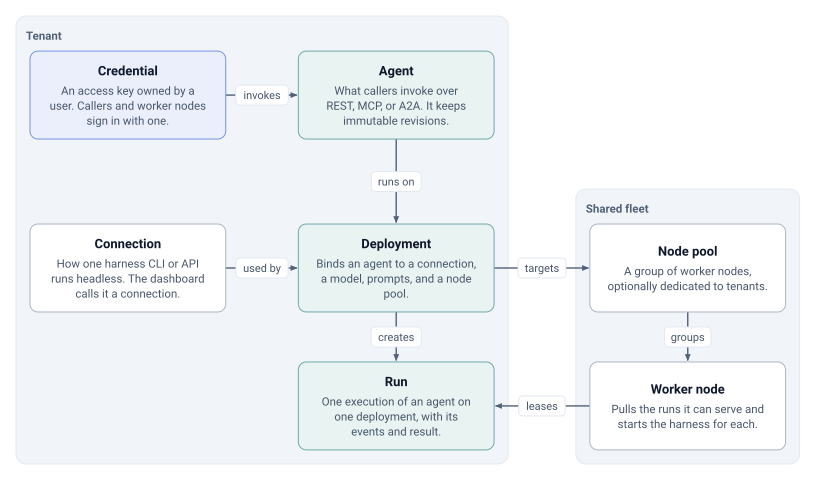
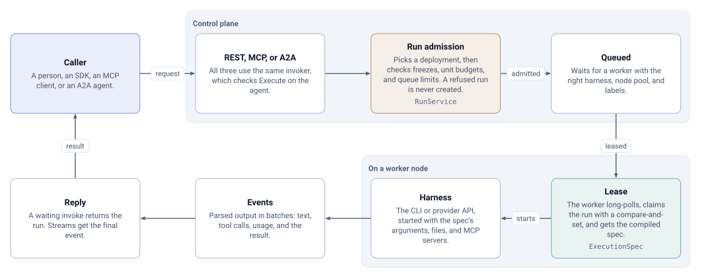
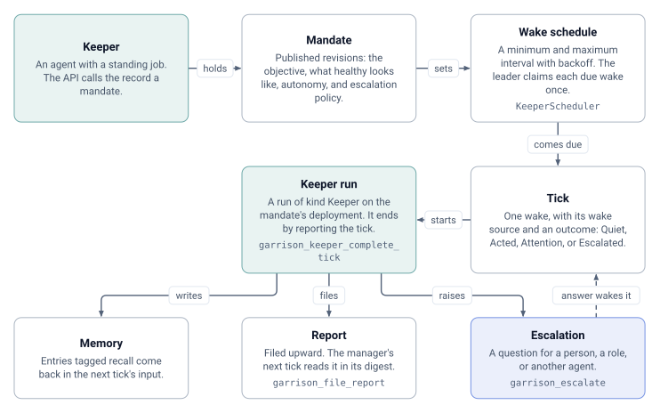
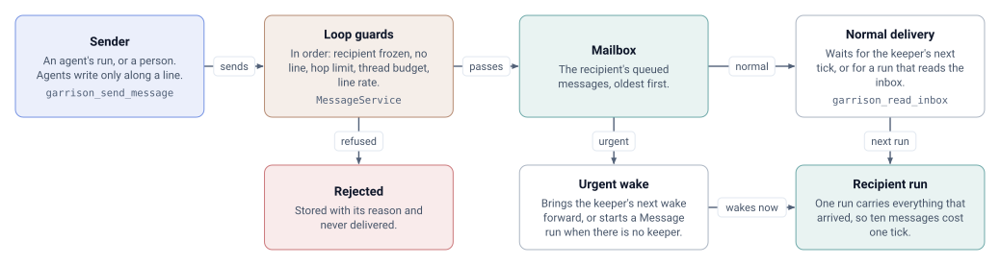

# Architecture

Garrison is two things built on one model. The runtime is a control plane for headless agent harnesses: it accepts requests to run an agent over REST, MCP, or A2A, turns each request into a fully resolved command line, and hands that to a worker that pulls it. The studio (Garrison Agent Studio) sits on top of the runtime and uses it to build, test, deploy, and serve agentic apps: drafts, the agent architect, the playground, promotion, and an end-user app gateway. Nothing in the studio bypasses the runtime. The architect is an agent, playground runs are runs, and an app's conversation is a series of runs with its entry agent. Autonomy, new in 0.3.0, follows the same rule: keepers, organizations, executives, and evaluations start ordinary runs and decide when to start them ([Autonomy on top of the runtime](#autonomy-on-top-of-the-runtime)).

This page describes the parts, how a run moves through them, and the decisions that shape the design. `archive/GARRISON_PLAN.md` and `archive/AGENT_DESIGN_DEPLOY_PLAN.md` have the full decision logs, and `AUTONOMOUS_AGENTS_PLAN.md` has the 0.3.0 decisions.

## The parts

```text
     operators: dashboard, SDKs, curl, MCP clients, A2A agents        end users: app UI at /apps/{slug}/
                                |                                                  |
                 +--------------+---------------------------------------------------+-----------+
                 |  REST + SSE + WebSocket + A2A  :8700      app gateway /v1.0/apps/{slug}/      |
                 |  MCP (proxy -> Voltaic loopback) :8701    (app sessions only)                 |
                 |  studio: drafts, diff, DraftApply approvals, playground, promotion            |   control plane ("Command")
                 |  scheduler, fan-out groups, capability catalog, file space and asset service  |   N replicas; shared state
                 |  autonomy: keepers, mailboxes, org resolver, executives, evals, brakes        |
                 |  Prometheus :9464                                                             |
                 +---------------------------------------+---------------------------------------+
                                                         |
                                              Sqlite or PostgreSQL
                    (state, leases, drafts, revisions, the event backplane: LISTEN/NOTIFY or a polled table)
                    artifact stores (Database, Filesystem, S3): artifacts, assets, file spaces, checkpoints
                                                         ^
                 +---------------------------------------+---------------------------------------+
                 |  register, heartbeat, lease (long poll), started, events, complete, drain     |   workers ("Post")
                 |  asset download and hash check, file space sync in and out, health :8710      |   M replicas, pull only
                 +-------------------------------------------------------------------------------+
                                     | spawns (Process) or creates a pod per run (KubernetesJob)
              claude / codex / gemini / mux / opencode / pi / provider API / any CLI
                   (the agent architect, app members, and fan-out members are all runs here)
```

| Component | Project | Responsibility |
|---|---|---|
| Control plane | `src/Garrison.Server` | Authentication, authorization, the REST, A2A, WebSocket, and MCP surfaces, scheduling, the node protocol, leader-elected maintenance |
| Core library | `src/Garrison.Core` | Models, the Sqlite and PostgreSQL data layer, security primitives, the template language, the invocation compiler, manifests, built-in seeding |
| Harness library | `src/Garrison.Harnesses` | Process runner, output parsers, outcome classification, secret scrubbing, MCP pre-flight, harness probes |
| Worker | `src/Garrison.Worker` | Registration, heartbeats, lease/start fencing, Process/KubernetesJob/remote executors, per-run directories and snapshot/cache transport, event buffering, health |
| Fake harness | `src/Garrison.FakeHarness` | A deterministic stand-in for Claude Code, Codex, and Mux used by tests, the smoke test, and the examples. It can also make scripted MCP calls, which is how the tests drive fan-out and the architect without a model |
| Dashboard | `dashboard/` | React operator console over the REST and WebSocket APIs |
| App UI | `app-ui/` | React end-user chat UI for agentic apps over the app gateway, served by the dashboard image under `/apps/` |
| SDKs | `sdk/` | C#, Python, JavaScript and TypeScript, and Go clients |

Each control-plane replica registers itself in `control_nodes` and heartbeats it every 5 seconds with its status (`Starting`, `Ready`, `Draining`, `Offline`), version, schema version, backplane, and activity (requests in flight, open streams, held long polls), the way workers heartbeat their `nodes` rows. `GET /v1.0/api/control-nodes` shows both kinds of node side by side with the workers, marks the replica that holds the leader lease, and names the replica that answered (`respondingNodeId`). See `docs/SCALING.md`.

The control plane is assembled from four modules, each registering its routes and services: identity (tenants, users, credentials, roles, permissions, assignments, sessions, audit, request history, settings), configuration (harness profiles, prompt templates, MCP servers, secrets, workspaces, artifact stores, agents and their revisions, deployments, promotions, manifests, agent assets, the capability catalog, agentic apps and the app gateway, file spaces, and studio drafts), runtime (runs, nodes, node pools, the scheduler, the node protocol, maintenance, WebSocket), and protocols (MCP and A2A). All HTTP is served by Watson 7. MCP is answered by Voltaic on a loopback port behind a small Garrison relay on the MCP port, which maps cluster-wide MCP session identifiers to Voltaic's in-process sessions so that any replica can serve any MCP session.

## The life of a run

The same records seen as one tenant uses them: a deployment ties an agent to a harness profile and a node pool, and a worker node in that pool runs each run. The Learn page in the dashboard draws these diagrams with links to each page.



The numbered steps below follow one request through those parts:



1. **Request.** A caller invokes an agent through `POST .../agents/{id}/invoke`, the MCP tool `garrison_invoke_agent`, or the A2A method `SendMessage`. All three go through the same invoker. The caller is authenticated, and Execute on Agent is checked.
2. **Deployment selection.** For a hosted agent, the invoker picks one of the agent's active deployments, at random by weight unless the caller named one, and validates the run parameters against the deployment's allowed overrides. Delegated calls are checked against the delegation rules here. Remote registrations instead select the RemoteA2A or RemoteMcp executor without creating a hosted deployment; the worker performs bounded health/TTL checks and an outbound call (see [remote agents](REMOTE_AGENTS.md)). A delegated call that waits records the calling run as waiting on the child before the child is created, and fails at once with `DelegationCapacityExhausted` when waiting could leave no capacity to run it.
3. **Queued.** The run is written as `Queued`, with its requirements (harness type, node pool, node labels) copied from the deployment. If the caller sent an idempotency key that matches a run from the last 24 hours, that run is returned instead.
   While a run is queued, every read explains whether anyone can take it: `blockedReason` is `NoReadyWorker` (no node is Ready), `NoCapableWorker` (no Ready node reports the run's harness), `NoMatchingPool` (capable nodes exist but none matches the deployment's node pool, tenant dedication, or node selector), or `NoIsolatingWorker` (an `Untrusted` run that no Ready node with its harness can isolate, or a run whose deployment has an egress allowlist that no Ready node can enforce), `NoToolWorker` (the run's agent uses a harness built-in tool, such as pandoc, that no capable Ready node reports), and `null` otherwise. It is computed from a node snapshot reused for a few seconds, never stored, and the tenant overview counts such runs as `blockedRuns`.
   Configured cluster, tenant and agent queue limits are enforced atomically at admission; `QueueFull` returns HTTP 429 with `Retry-After`. Tenant weights guide run-count service across bounded candidate windows, not reserved CPU capacity (see [tenant scheduling](TENANT_SCHEDULING.md)).
4. **Claimed.** A worker's long-poll lease request finds candidate runs it is eligible for (harness, node pool, and tenant dedication are filtered in SQL) and claims one with a single compare-and-set update that also increments the run's fencing epoch. Only one claim can succeed. When the deployment has `maxConcurrentRuns`, claims for that deployment are serialized in the database and the update counts its active runs, so the limit is exact across replicas; a delegated run's ancestors in the same deployment that wait on a descendant are not counted. Delegated runs are claimed ahead of new top-level work, and a worker's child reserve takes only runs whose parent waits on them (see "Delegation capacity" in `docs/SCALING.md`). A long poll waiting on one replica is woken through the event backplane when a run is queued on another.
5. **Compiled.** The claiming replica loads the deployment, profile, agent, prompt bindings, MCP servers, secrets, and workspace, issues scoped run credentials when the compiled features require them, and renders everything into an `ExecutionSpec`: executable, argument list, environment, files, stdin, parser, result source, success policy, timeouts, MCP checks, and the values to scrub. The template versions used are recorded on the run. A compile failure fails the run with `CompileFailed`.
6. **Leased.** The spec goes back to the worker in the lease response, with the epoch and lease expiry.
7. **Running.** Before anything is launched, the worker passes the start gate: it reports `started` for its epoch and waits for the control plane's acknowledgement, which moves the run from Leased to Running. A worker that is refused (409 `StaleLease`) or cannot get the acknowledgement before its lease expires abandons the run without launching it, so a run that is still Leased has never started anywhere. The worker then creates the run's directories, writes files, runs MCP pre-flight, and starts the process. It parses stdout into normalized events (text, tool calls, usage, results) and sends them in batches. Heartbeats extend the lease. The run guards watch the same events and stop the harness when its text degenerates into repetition, grows past `maxAssistantChars`, or nothing happens for `noProgressSeconds` (see `docs/HARNESSES.md`). A run whose deployment uses the `KubernetesJob` executor follows the same steps inside a pod of its own: the worker creates a Job and a spec Secret, the pod's `garrison-worker run-one` does the work above, and the worker relays its nonce-prefixed stdout lines as events while it keeps the lease (`docs/KUBERNETES.md`, "Pod-per-run executor").
8. **Finished.** When the process exits, the worker classifies the outcome, reads the result, scrubs secrets, reports `complete`, and cleans up. The control plane stores the result, usage, cost, served model, exit code, and stderr tail, revokes the run token, and wakes anyone waiting.
9. **Delivered.** A waiting invoke returns the run. Run and pipeline waits share a bounded per-replica wait pool. When it is full an external invocation returns its accepted run with HTTP 202 for polling; pipeline creation retains HTTP 201. It does not create a duplicate run or cancel accepted work. Resident synchronous delegation reserves a wait slot before creating its child and fails with `DelegationCapacityExhausted` if none is available. Streaming clients receive the final event over SSE, WebSocket, or A2A streaming.

Meanwhile the leader's maintenance loop (every 2 seconds) requeues or fails runs whose lease expired (a Leased run never started and is requeued while it has attempts left; a Running run follows its admitted policy: `AtLeastOnce` permits replay, and `AtMostOnce` fails with `NodeLost`; `Journaled` additionally permits recovery only with accepted same-attempt coverage/checkpoint proof and no uncertain dispatched operations, so raw CLI work normally fails conservatively; every requeue revokes the expired attempt's run tokens), enforces deadlines as a backstop to the worker (including the cluster cap `Runtime.MaxRunSeconds` for runs compiled with a later deadline), marks silent nodes `Lost` and silent control-plane replicas `Offline`, fires cron triggers that came due (claiming each occurrence with a compare-and-set, see `docs/TRIGGERS.md`), queues notifications for runs, pipeline runs, and approvals that finished or appeared since its last pass (see `docs/NOTIFICATIONS.md`), and prunes old records. Every replica, leader or not, also runs a notification dispatcher that claims due deliveries from the outbox and sends them. Every 5 seconds it also looks for blocked queued runs: the first time a run is blocked for a given reason it appends one `Warning` run event saying why (the event carries a marker in its raw JSON so a new leader does not repeat it), and when the cluster setting `Runtime.FailBlockedAfterSeconds` is above 0 it fails runs that stay blocked that long with outcome `NoCapableWorker`. Because the control plane can write events before a worker sees the run, each lease tells the worker which sequence to number its events after (`eventSequenceStart`).

### Conversations

A conversation is a series of runs with one agent that share a harness session (plan P12.1). A turn names its conversation (`conversationId` on invoke, `contextId` over A2A). The control plane serializes turns with a compare-and-set on the conversation's active run, so a turn sent while the previous one is unfinished gets 409 `ConversationBusy`. A follow-up turn carries the session to resume and an affinity node, the worker that ran the last successful turn and holds the conversation's directories; other workers leave it queued until `Runtime.ConversationAffinityWaitMs` has passed or that worker stops being Ready. A turn claimed elsewhere, or one whose worker no longer has the directories (reported as `ConversationStateLost` and requeued), becomes a fallback: a fresh session whose prompt repeats the earlier turns from a prompt template. The `ConversationFallback` event, the run's `conversationFallbackReason`, and the conversation's fallback count record it. See Conversations in `REST_API.md`.
### Permission approvals

A deployment with `approvalsEnabled` puts its harness's permission requests through Garrison (P12.3). Claude Code calls the MCP tool `garrison_permission_prompt` through `--permission-prompt-tool`; for Codex app-server runs the worker calls it on the harness's behalf. The tool runs on whichever replica the MCP request reached: it evaluates the deployment's approval rules, records an `Approval`, and for a resident Ask holds the call open until the approval is decided. Durable suspension uses the checkpoint response described below. A decision on any replica is a compare-and-set on the row plus an `ApprovalChanged` backplane message that wakes the held call. Without durable suspension, the run stays `Running` (with `awaitingApproval`) and keeps its slot. With `suspensionEnabled`, a compatible Process harness finishes its turn at the denied operation, records a valid session checkpoint, and moves to `Suspended`, releasing its lease and slot. A human decision requeues the same session for restoration on an eligible Process worker; an exact reviewed operation receives a one-time durable grant and a current explicit Deny still wins. The same checkpoint mechanism supports synchronous child waits. Marker-only output without a current durable wait cannot suspend a run. See [continuation](CONTINUATION.md) for the boundary and archive policy. The worker learns about approvals of its runs from the same watch long poll that delivers cancellations and records them as run events, because the worker is the only writer of a leased run's events.

### Cancellation

A cancel request (REST, MCP `garrison_cancel_run`, A2A `CancelTask`, or a caller going away) cancels the run's pending permission approvals, moves a queued or suspended run straight to `Cancelled` and a leased or running run to `Cancelling`, then wakes the worker that holds it. Each worker keeps one long poll open, `POST /v1.0/api/node/watch`, naming the runs it is executing; the control plane answers it as soon as one of them is cancelled, on any replica, because the cancel publishes a node signal over the event backplane. The worker then sends the harness and its child processes SIGTERM and, after the profile's `killGraceSeconds`, SIGKILL. The heartbeat (every 5 seconds by default) still carries cancellations, as a fallback for workers or control planes without the watch. In the test suite a cancel request turns into a `Cancelled` run in under 100 ms for a harness that exits on SIGTERM, and in about 1.1 seconds for one that ignores SIGTERM with a 1-second grace.

Cancelling a run cancels the runs it delegated that have not finished, and their delegated runs, down the whole tree. Callers that stop waiting cancel their runs as well, so an abandoned request does not keep a model busy until its deadline:

- REST `invoke`, deployment `test`, and `POST .../runs` with `wait=true`: the client disconnecting (Watson reports the closed connection) cancels the run, unless the request set `cancelOnDisconnect` to false. A wait that simply times out returns 202 and leaves the run alone.
- MCP `garrison_invoke_agent`: Voltaic cancels the tool call when the client sends `notifications/cancelled` for it or deletes or closes the session, and the call cancels its run. A `notifications/cancelled` that reaches a different replica than the one running the call is relayed over the backplane.
- A2A blocking `SendMessage` and `SendStreamingMessage`: the client disconnecting before the task finishes cancels it. Re-subscribing to a task (`SubscribeToTask`) and closing that stream does not.

A control-plane replica that is shutting down never cancels runs on its callers' behalf; they keep running and can be read from another replica.

### Run states

```text
Pending -> Queued -> Leased -> Running -> Succeeded | Failed | TimedOut | Cancelled
              ^         |          |
              +---------+----------+   lease expired with attempts left (Running replay follows admitted effect policy/proof)
           Running -> Suspended -> Queued (accepted durable wait/checkpoint and later decision or child completion)
           Queued/Suspended -> Cancelled
           Leased/Running -> Cancelling -> Cancelled
           Queued -> Failed (outcome NoCapableWorker, only when Runtime.FailBlockedAfterSeconds > 0)
           Leased -> Rejected (outcome Rejected: admission refused when the run is claimed)
```

`Rejected` means the run was accepted but never started. When a worker claims a run, the control plane checks admission again before it compiles the run: if the run's tenant, agent, or deployment was deactivated or deleted while the run waited in the queue, the run ends `Rejected` with outcome `Rejected` and an error message that names what changed, instead of starting or failing to compile. The worker never sees it. A request that is refused up front (an inactive agent, no active deployment) still answers 409 and creates no run.

A run's `outcome` explains a `Failed` status: `HarnessFailed`, `NotInstalled`, `NotCredentialed`, `McpPreflightFailed`, `NodeLost`, `OutputLimitExceeded`, `RepetitionDetected`, `NoProgress`, `PodFailed`, `CompileFailed`, and so on (see `docs/HARNESSES.md`).

## The studio on top of the runtime

The studio adds no second execution path. It adds configuration that is reviewed before it goes live, and a way for end users to reach the result.

**Drafts and approval.** A studio draft holds manifest documents. People and the agent architect edit it through REST or the studio MCP tools, each change naming the draft version it read; every change publishes a `studio-draft:{draftId}` WebSocket message, so a chat panel and a canvas over the same draft stay in step without private state. A diff compares the draft with live configuration through a manifest dry run. Applying it creates a `DraftApply` approval, and only a person's decision runs the manifest apply, publishes the changed agents' revisions, and repins their `dev` deployments. See [STUDIO.md](STUDIO.md).

**The architect is a run.** `agent-architect` is a seeded, protected agent. Its deployment carries `managementAccess: Drafts`, so the run token minted for each architect turn can call the draft tools for the person who started it, and the compiler renders its `System` prompt from whichever architect prompt the deployment selects, at that template's current version unless pinned. See [ARCHITECT.md](ARCHITECT.md).

**Revisions, environments, promotion.** Agents keep immutable revisions; deployments pin one or follow the latest published revision, and carry an environment label. The compiler reads agent fields from the effective revision. Promotion repins the next environment's deployments in one transaction and records the previous pins for rollback. Playground runs use a temporary deployment in the reserved `draft` environment. See [REVISIONS.md](REVISIONS.md).

**Assets and file spaces travel in the ExecutionSpec.** At lease time the spec lists each pinned asset file with its hash, target path, and a short-lived download ticket, and names the run's conversation file space. The worker downloads and verifies assets, syncs the file space into the workspace before launch, and writes changed files back, fenced by the run's epoch, before cleanup. For KubernetesJob runs the worker does the transfers and passes bytes to the pod, so pods still hold no credentials. See [ASSETS.md](ASSETS.md) and [FILE_SPACES.md](FILE_SPACES.md).

**Fan-out is delegation in parallel.** `garrison_fan_out` admits every member through the same delegation checks and capacity handshake as a single waited delegation, and records a fan-out group. Groups are evaluated when a member finishes, when the parent gathers, and by the leader sweep. With `suspensionEnabled`, gather checkpoints the parent through the existing continuation path. See [FAN_OUT.md](FAN_OUT.md).

**The capability catalog** is derived: agent descriptors from published revisions, MCP tools from cached tool lists, and host tools from worker tool probes that become node labels and run requirements. See [CAPABILITIES.md](CAPABILITIES.md).

**The app gateway.** An agentic app maps a slug to an entry agent and its deployment in the app's live environment. `/v1.0/apps/{slug}/` accepts only app session tokens, starts conversations on the entry deployment, and streams turn events and file changes as server-sent events that resume after `Last-Event-ID`. Runs started through an app run as the app, with the end user recorded as the caller, and the app's edges supply each member's delegation allow list. The `app-ui/` single-page app is served by the dashboard image under `/apps/`. See [APPS.md](APPS.md) and [APP_UI.md](APP_UI.md).

## Autonomy on top of the runtime

Version 0.3.0 lets agents start work on their own, and it does so the same way the studio did: without a second execution path. A keeper tick is a run of kind `Keeper`, a message that wakes an agent with no keeper is a run of kind `Message`, and every eval case and shadow copy is a run of kind `Eval` or `Shadow`. Leases, fencing, quotas, transcripts, and telemetry apply to all of them unchanged. What 0.3.0 adds sits around that path: a scheduler that decides when to start a run, mailboxes and reports that carry text between runs, an org resolver that says who stands where, and two reviewed paths for change, one for executives and one for evaluation. `AUTONOMOUS_AGENTS_PLAN.md` holds the decisions (AA-nnn) behind each piece.

```text
   people: board members, operators                  runs: a run token calling Garrison's MCP server
   (REST, MCP, dashboard, SDKs)                       gateway on every call: session, lease epoch, ShadowRunPolicy,
        |                                             then the effect journal for every non-read tool
        | freezes, direction, answers,                    |
        | change rules, approval decisions                | send_message  file_report  escalate  memory writes
        |                                                 | studio draft tools  keeper_complete_tick
        v                                                 v
 +--------------------------------------------------------------------------------------------------------+
 |  org resolver: ChainOfCommand. The live revision of every Active or Frozen organization, cached by     |
 |  revision ID (snapshots never change). Managers, chains, direct reports, subtrees, reporting and peer  |
 |  lines. Asked by MessageLinePolicy, ReportVisibility, MemoryAccessPolicy, escalation routing,          |
 |  FreezeService, OrgBudgetGuard, and ExecutiveAuthority, so they all agree on who manages whom.         |
 +-----------+--------------------------+---------------------------+-------------------------+----------+
             |                          |                           |                         |
   mailboxes                  executive path               evaluation path            brakes
   agent_messages rows        draft written by an          EvalRunner (leader):       FreezeService cache
   loop guards first;         OrgSubtree run               case runs of kind Eval,    (FreezesChanged on
   Rejected rows kept         ExecutiveDraftValidator      scorers and judge runs     the backplane)
   Normal: Queued until       ChangeClassifier             EvalGateService gates      mandate spend caps
   the next delivery          ChangeRuleMatcher + gates    promotion, rules, canary   OrgBudgetGuard and
   Urgent: wake the keeper    covered: apply as the        ShadowTrialService copies  the overrun freeze
   or start a Message run     person; else DraftApply      finished runs as Shadow    kill switch freeze
             |                          |                           |                         |
             v                          v                           v                         v
 +--------------------------------------------------------------------------------------------------------+
 |  keeper scheduler (KeeperScheduler, leader sweep): finish ended ticks, claim due wakes with one        |
 |  compare-and-set on the mandate's next wake and active tick, record Skipped wakes, start Keeper runs.  |
 |  Tick input: keeper-tick + escalation-answered + memory-recall + report-digest + board-brief +         |
 |  inbox-delivery, every agent-written part framed as data.                                              |
 +--------------------------------------------------+-----------------------------------------------------+
                                                    |
     RunService admission: freezes, unit budgets ---+--> Queued --> lease --> compile (system prompt gains
     (a refused run is never created)                    keeper-system, org-context, executive-system) --> worker
```

A keeper's pieces, before the details below: the mandate sets a wake schedule, each due wake is a tick that starts a `Keeper` run, and that run writes memory, files reports, and raises escalations. Mail between agents takes the second picture's path, through the loop guards into a mailbox.





### The keeper scheduler

`KeeperScheduler` runs on the leader's maintenance pass, every `Autonomy.SchedulerSweepSeconds`. Each sweep first finishes ticks whose run has ended: a run that never called `garrison_keeper_complete_tick` records `Unreported`, or `Failed` when the run failed or timed out, and the next wake is computed from the outcome and the revision's schedule (AA-014, AA-036). Run completion finishes the tick at once as well; the sweep is the backstop for runs that ended by cancellation, timeout, a lost node, or a replica that died between the claim and the run (AA-032). The sweep then claims due mandates with one compare-and-set on the mandate's next wake time and active tick, so any number of replicas start exactly one tick per wake. Up to `Autonomy.MaxDueClaimsPerSweep` wakes are claimed per sweep, `Autonomy.SchedulerSweepConcurrency` of them at a time; since each claim is its own compare-and-set, starting them in parallel changes nothing about which replica wins. A timer wake that comes due while a tick still runs is recorded as `Skipped` and moves on by one interval; a manual, message, or escalation-answer wake waits and starts when the running tick ends (AA-037).

Before starting a tick the scheduler checks the brakes that apply to wakes: freezes in the mandate's scope, the kill switch, the revision's day budget (which moves the mandate to `CapReached`), and the unit budgets above the agent (a breach records a `Skipped` tick with `BudgetExhausted`, tells the capped unit's manager, and freezes the unit once spend passes the organization's margin). Then it renders the tick's input. `builtin/keeper-tick` says why the keeper woke and how recent ticks went, and the answered escalations, recalled memory, subordinates' new reports, the board brief request for a CEO, and claimed mail follow, each rendered by its own template. The compiler appends `builtin/keeper-system` to the system prompt of every keeper run, and `builtin/org-context` and `builtin/executive-system` when the agent holds a position in a live organization or leads a unit as an executive ([KEEPERS.md](KEEPERS.md), [PROMPTS.md](PROMPTS.md)).

### Mailboxes

An agent's mailbox is its rows in `agent_messages`. `MessageService` checks every send before it stores it: the recipient must not be frozen, a line must join the two agents (an app edge, a reporting or peer line from the org resolver, or a reply in a thread, per `MessageLinePolicy`), and the hop limit, thread budget, and per-line rate must hold. A refused message is stored as `Rejected` with its reason, so a loop shows up in the console instead of vanishing. A send from a run derives a key from the run and the message content, so a replayed send returns the first message.

Normal mail stays `Queued` until a delivery claims it with a compare-and-set: the recipient keeper's next tick, a `garrison_read_inbox` call, or a `Message` run. Urgent mail brings the recipient keeper's next wake forward to now (wake source `Message`), or starts a `Message` run on the agent's default deployment when it has no keeper, as the person behind the sender (`WakeCaller`). Urgent wakes are capped per recipient per hour, and while the kill switch is on urgent mail waits like normal mail. Because a keeper runs one tick at a time, ten messages that arrive during a tick are handled by the one tick that follows ([MESSAGING.md](MESSAGING.md)).

### The org resolver

`ChainOfCommand` is the one place that answers organization questions at run time: where an agent sits in each live organization, its managers, the chain above it, its direct reports, the agents in a unit's subtree, and whether a reporting or peer line joins two agents. Only organizations that are `Active` or `Frozen` and have a published revision count. Published revisions never change, so their units are cached in memory by revision ID; the list of live organizations is read on every call, so a publish or rollback on one replica is seen by every other replica on its next question, with no backplane message needed.

Escalation routing to a manager, report visibility, memory scopes, message lines, `OrgUnit` freezes, unit budgets, and executive authority all ask it, so they never disagree about who manages whom. The compiler reads the same live revision through `OrgContextLoader` in `Garrison.Core` to render `builtin/org-context` for member runs ([ORGANIZATIONS.md](ORGANIZATIONS.md#the-chain-of-command)).

### The executive path

An executive is a run whose deployment has `managementAccess: OrgSubtree` and whose agent leads exactly one unit in a live organization. `ExecutiveAuthority` works that position out from the live chart on every call, so an agent that stops leading a unit loses its authority at once, including over drafts it already wrote. The executive writes an ordinary studio draft through the studio MCP tools, and the draft records the unit it was written from.

Every diff of such a draft, and every request to apply it, runs the executive review in `StudioService`. `ExecutiveDraftValidator` (in `Garrison.Core`) applies the hard limits of AA-022: every changed item must lie strictly below the executive's unit, and nothing may touch the executive's own agent, deployments, mandates, or unit, anything above it, a secret or credential reference, a budget going up, or any deployment's `managementAccess`. `ChangeClassifier` sorts each change into change classes, and `ChangeRuleMatcher` matches them against the person-written change rules in force, with eval gates read from `EvalGateService`. A draft that breaks a hard limit is refused with `DraftInvalid`. A draft that rules fully cover, started by a person who holds Create on `Manifest`, applies at once as that person through a `DraftApply` approval decided with source `Rule`. Anything else waits for a person like any draft. Each executive apply publishes one organization revision and saves a revert draft, so an organization rollback also undoes what the executive changed ([EXECUTIVES.md](EXECUTIVES.md)).

### The evaluation path

`EvalRunner` drives eval runs from the leader's maintenance pass, so a run a former leader was driving resumes on the new one. It runs each case as a run of kind `Eval`, against a deployment or against an agent revision on an ephemeral copy in the `draft` environment, at most `Evaluation.MaxConcurrentCases` at a time. Each output is scored with its checks (`ExactMatch`, `Contains`, `JsonSchemaValid`, or `Judge`, where `EvalJudgeRunner` starts the judge agent as another `Eval` run). Case and judge runs carry idempotency keys derived from the eval run and the case order, and status changes are compare-and-set, so two replicas never double-run a case. The runner stops starting cases when spend reaches the eval run's budget.

`EvalGateService` turns results into decisions. A promotion into an environment that names an eval set needs a completed eval run of that revision on the latest version of the set a person approved. A change rule's gate also accepts a set written by an evaluator agent outside the executive's subtree (AA-024), and hidden cases never reach the proposer's run tokens (`HiddenEvalRunPolicy`). `ShadowTrialService` copies a sample of a source deployment's finished runs to a candidate as `Shadow` runs, after the source run has finished and off its completion path. `CanaryService` moves deployment weights in steps on the leader's sweep and rolls them back when the error rate or eval score crosses its threshold. Eval and shadow run tokens are restricted by `ShadowRunPolicy` on every gateway call: they may read, and every tool the effect journal would record is refused (AA-027, AA-074) ([EVALS.md](EVALS.md)).

### Brakes

Freezes, spend caps, unit budgets, and the kill switch are checked in the control plane, at admission in `RunService` and before each keeper wake, so a refused run is never created and the brake holds whatever the agent does. `FreezeService` keeps each tenant's active freezes in a short cache; a change drops the entry locally and publishes `FreezesChanged` on the backplane, and every entry expires after 30 seconds in case a message is lost (AA-047). The kill switch is itself a freeze with target kind `TenantAutonomy` (AA-046). `OrgBudgetGuard` refuses runs of agents in a subtree that has spent its unit budget, and `OrgBrakeService` cancels everything in a unit's subtree in one audited action. Run tokens never hold the Freeze permissions ([BRAKES.md](BRAKES.md)).

### Text between agents

Memory, reports, messages, escalation answers, and briefs are written by agents and read by other agents, so they are a prompt-injection channel. They are untrusted data (AA-025): each reaches a prompt only through its template (`builtin/memory-recall`, `builtin/report-digest`, `builtin/inbox-delivery`, `builtin/escalation-answered`, `builtin/board-brief`, and so on), framed as data with its provenance and never as instructions. The memory, report, and message templates put the text between begin and end markers chosen at random for every render, so the text cannot close its own frame. Every mutation a run makes through its run token goes through the gateway's effect journal (AA-026), which records the operation as `Authorized`, `Dispatched`, and `Completed` under the run's lease epoch; a run whose lease moved on is refused before anything is written. Sends, filings, and escalations also deduplicate a replay from the same run, so a recovered run does not double-send ([SECURITY.md](SECURITY.md), [effect safety](effect-safety.md)).

## Design decisions

**Workers pull.** The control plane never opens a connection to a worker. Workers need only outbound access to the REST port, which makes them easy to run in other clusters, behind NAT, or on developer machines, and lets the two halves scale on their own.

**Compile on the control plane.** Workers receive a resolved spec and never read the database, render a template, or decrypt a stored secret. One component owns configuration semantics, worker upgrades rarely matter, and a compromised worker learns only what its own runs needed.

**Harnesses are data.** Command lines, environment, config files, and output parsing are described in harness profiles built from templates, so supporting a new CLI flag or a new CLI is a configuration change. Only output parsers are code.

**Every prompt is a template.** System prompts, task wrappers, delegation instructions, tool descriptions, and harness config files are versioned prompt templates, bound per deployment and recorded per run.

**Fencing over trust.** Leases expire and epochs increase on every claim, so correctness never depends on a worker noticing it lost a run. A stale worker's reports are refused.

**The database is the bus.** Events, status, settings, sessions, leases, signed-request nonces, rate limit counters, and MCP sessions go through the database rather than an in-memory bus, so any replica can serve any client. An event backplane (PostgreSQL LISTEN/NOTIFY by default, or a polled table) carries small hints between replicas: a run changed, work was queued, settings or permissions changed, an MCP session closed. Hints only make waiters look at the database sooner; every waiter still re-reads the database on its own interval, so a lost hint costs latency, never correctness. `docs/SCALING.md` lists every piece of in-memory state and why it is safe.

**One migrator.** Replicas take a database startup lock (a PostgreSQL advisory lock) before migrating and seeding, so replicas starting together never race; the others wait, answering liveness but not readiness, until the schema is current.

**Multi-tenant from the start.** Every tenant-owned row carries a tenant identifier. Resource queries filter on the resolved route tenant and enforce the principal's authorization; a resource ID supplied under the wrong tenant answers 404. System administrators can explicitly operate across authorized tenant routes.

**Passwords are slow to guess.** User passwords are stored as PBKDF2-HMAC-SHA256 with a random 16-byte salt and 600,000 iterations (`Auth.PasswordHashIterations`), encoded as `pbkdf2-sha256$<iterations>$<salt>$<hash>` so the algorithm and work factor can change later without a migration. Hashes from earlier builds (unsalted SHA-256) still sign in, and the first successful sign-in replaces them; a hash with fewer iterations than configured is upgraded the same way. Comparisons are constant time, and an unknown or inactive account costs the same verification time as a real one, so response times do not reveal which accounts exist. Credential secret keys are not hashed: they are encrypted, because signed requests need the secret itself.

**Structured storage.** Records are stored as columns and child tables, not JSON blobs, apart from a few deliberately unmanaged fields such as agent schemas and raw harness events.

## Operational boundaries

Hosted gateway mutations have durable intent/outcome records and lease-epoch fencing, but an external request already sent cannot be recalled. Static third-party credentials do not acquire Garrison fencing. The optional HTTP credential broker issues bounded credentials and records/retries revocation obligations; provider enforcement and expiry remain part of its contract. See [effect safety](effect-safety.md) and [credential broker](CREDENTIAL_BROKER.md).

Optional agentic memory is disabled by default. When enabled, tenant-scoped memory is accessed through `IAgentMemoryStore`; the configured filesystem implementation is replaceable behind that interface. Optional external memory services are deployment choices rather than a required NotDory dependency. See [agent memory](AGENT_MEMORY.md). Filesystem-backed memory and artifacts require consistent durable storage across the replicas that serve them; affinity-free API routing does not replicate those files.

Run placement and database-usage diagnostics are read-only Run Read endpoints. Placement explains a multi-read eligibility snapshot without reserving a slot; database usage reports exact counters from completed instrumented scopes, not all causally related database activity. See [scaling diagnostics](SCALING.md#explain-a-runs-placement).

## Data model

```text
Tenant
 +- User --- Credential
 |    \______ role assignments (tenant or resource scope) ___ Role --- Permission
 +- HarnessProfile (arguments, environment, files, asset placements, tool probes)   (built-ins shared)
 +- PromptTemplate (versions, variables)                                             (built-ins shared)
 +- McpServer (headers, environment)   Secret   WorkspaceTemplate   ArtifactStore
 +- TenantEnvironment (ordered labels: dev, staging, prod)
 +- AgentAsset --- AgentAssetVersion (files, SHA-256 content in an artifact store)
 +- Agent (latest published and draft revision pointers)
 |    +- AgentRevision (content, prompt pins, allow list, asset pins, capabilities)
 |    +- Deployment (profile, prompt bindings, resource bindings, environment, revision pin,
 |                   managementAccess, overrides, parameters, node selector)
 +- PromotionRecord (previous and new pins per deployment)
 +- AgenticApp (members, edges, environments, branding) --- AppRevision   AppSession
 +- StudioDraft (items, layout, version)
 +- CapabilityDescriptor (agent, MCP tool, harness built-in, manual; hints)
 +- ConversationFileSpace (conversation, pipeline run, or root run) --- files --- versions
 +- Run (parameters, requirements, template versions, revision, file space) --- RunEvent
 |    +- Approval (including DraftApply), child waits, FanOutGroup --- members
 |    +- EffectOperation, EffectCheckpoint, RunDatabaseUsage
 |    +- Artifact metadata (Database, Filesystem or S3 content)
 +- Mandate --- MandateRevision, MandateTick (each tick points at its Keeper run)
 +- Escalation   Freeze (including the TenantAutonomy kill switch)   AgentMessage
 +- MemoryEntry --- tags (content in the memory provider)   Report --- metrics, issues, decisions
 +- Organization --- OrgUnit (lead, members, peer lines, budgets) --- OrgRevision (unit snapshots)
 +- ChangeRule   EvalSet --- EvalCase (checks, files) --- EvalRun --- EvalCaseResult
 +- ShadowTrial   CanaryRelease --- steps
 +- Secret --- CredentialLease (broker metadata, never issued token values)
 +- AuditRecord, ManifestApply
NodePool (optional tenant dedication) --- Node (labels, capabilities, tool labels)
ControlNode (one per control-plane replica, keyed by its node ID)
RequestHistoryEntry, ClusterSetting, CoordinationLease, AuthSession
```

Identifiers are K-sortable strings with a type prefix (`agt_`, `run_`, `nod_`, and so on), so they sort by creation time and say what they refer to. Control nodes are the exception: a replica's row is keyed by its node ID (the pod name in Kubernetes), so a restarted process with the same name reuses its row.

## Surfaces

| Surface | Reference |
|---|---|
| REST, SSE, node protocol | `REST_API.md`, OpenAPI at `/openapi.json` |
| WebSocket live updates | `WEBSOCKETS_API.md` |
| MCP | `MCP_API.md` |
| A2A | `A2A_API.md` |
| App gateway (end users) | [APPS.md](APPS.md#the-app-gateway) |

The first four use the same tenants, credentials, and RBAC. The app gateway accepts only app session tokens, and the management surfaces refuse them.

## Further reading

[STUDIO.md](STUDIO.md), [ARCHITECT.md](ARCHITECT.md), and [APPS.md](APPS.md) cover the studio and apps; [KEEPERS.md](KEEPERS.md), [ORGANIZATIONS.md](ORGANIZATIONS.md), [EXECUTIVES.md](EXECUTIVES.md), [EVALS.md](EVALS.md), [BOARD.md](BOARD.md), and [BRAKES.md](BRAKES.md) cover autonomy; `docs/HARNESSES.md` and `docs/PROMPTS.md` cover configuration; `docs/MANIFESTS.md` covers declarative configuration; `docs/SECURITY.md`, `docs/SCALING.md`, and `docs/TELEMETRY.md` cover operations; `docs/DOCKER.md` and `docs/KUBERNETES.md` cover deployment and `docs/QUICKSTART.md` a first multi-agent setup; `docs/DEVELOPMENT.md` covers building and testing.


## Executor capability negotiation

Workers register an `executorCapabilities` record per executor. The server preserves legacy `executors` names for older clients; bare names make no advanced capability promise. Current Process workers report Process isolation, Immediate startup, and session continuation for harness profiles that support resume. Kubernetes workers report Container isolation and Cold startup, plus `warmStart=true` when their enabled warm pool has the necessary RBAC. This supports both cold Jobs and single-use warm Pods. Process workers also report filesystem snapshots and cross-node restore; durable use requires the compatible profile, isolated HOME and artifact store described in [continuation](CONTINUATION.md). KubernetesJob reports egress control only when its initialized per-run network-policy enforcement is usable. KubernetesJob and remote executors do not provide local durable session checkpoint/restore.

Deployments specify `requiredCapabilities`. Defaults retain existing placement. Set `executor: "KubernetesJob"` when requiring Container isolation. Isolation matches at least the required level; boolean flags must be supported and an optional startup class matches exactly. Session continuation also requires a harness profile with `supportsResume`. Requirements are copied into the run at admission, so changing a deployment does not change queued work.

A deployment's `trustLevel` (P11.14) feeds the same path. `ExecutorCapabilityRules.Effective` is the only place it becomes a placement requirement: `Untrusted` raises the isolation to at least Container on top of `requiredCapabilities`, and `ExecutorCapabilityRules.Admit` stores the result, the resolved executor (an unset executor on an `Untrusted` deployment resolves to KubernetesJob), and the trust level on the run. Candidate selection, the atomic claim, the delegated child reserve, and blocked-run detection then match the stored run columns, so trust composes with every other requirement and no claim path can skip it. `Untrusted` runs that no Ready worker can isolate report `NoIsolatingWorker`. A deployment's `egressRules` (P11.15) feed the same function: any rule adds `EgressControl` and at least Container isolation, so allowlisted runs go only to KubernetesJob workers that enforce the rules with a per-run NetworkPolicy, and report `NoIsolatingWorker` while none is Ready. The rules themselves travel to the worker in the `ExecutionSpec` compiled at lease time.

Capability predicates run in SQL before candidate limits, preventing unsupported work from hiding eligible runs. The lease update checks the current persisted report again. Unsupported requirements leave the run queued with `NoCapableWorker` and an explanation naming the requirements. Registration validates capability enum values and rejects duplicate reports. Reports describe a trusted worker's supported behavior; they are not independent security attestations.

Migration 17 stores requirements and reports in typed columns, including whether an executor has reported capabilities. It upgrades existing deployments and runs without imposing new requirements and preserves old worker names without inventing promises. The deployment editor exposes all requirements under execution; the worker table offers an optional capability column. Optional quotas and cost accounting retain their existing behavior.
