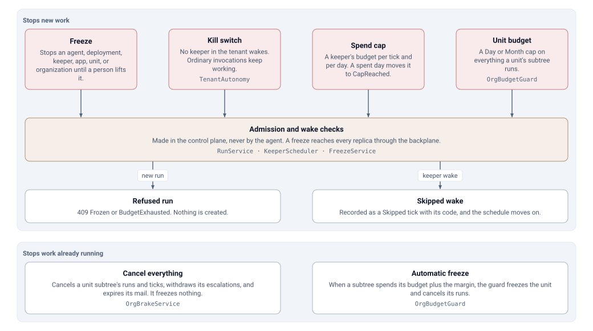

# Brakes

Keepers act on their own, so Garrison needs ways to stop them that do not depend on the agent cooperating. There are four:

- A **freeze** stops one agent, deployment, keeper, app, organization unit, or organization until someone lifts it.
- A **spend cap** stops a keeper that has spent its budget for the tick or the day.
- A **unit budget** stops every agent in an organization unit's subtree once the subtree has spent its budget for the day or month.
- The **kill switch** stops every keeper in the tenant at once.

For organizations there are also [org-scale brakes](#org-scale-brakes): cancel everything in a unit's subtree in one action, freeze a unit automatically when it overruns its budget, and roll back without leaving a tick on the wrong revision.

All four take effect in the control plane: a refused run is never created and a skipped wake never starts a tick, so the agent has nothing to argue with. Run tokens never hold the Freeze permissions, so an agent cannot lift a freeze on itself or turn the kill switch off.

Every brake that stops new work is checked in the same two places, at run admission and before a keeper wake. The two at the bottom act on work that is already running.



## Freezes

A freeze names a target:

| `targetKind` | What stops |
|---|---|
| `Agent` | Every new run of the agent, on any deployment, and every keeper bound to it |
| `Deployment` | Every new run on the deployment and every keeper bound to it |
| `Mandate` | The keeper's ticks. The mandate shows status `Frozen` until the freeze is lifted |
| `App` | Every run that users of the agentic app start through the app gateway |
| `TenantAutonomy` | Every keeper in the tenant. This is the kill switch; see [below](#the-kill-switch) |
| `OrgUnit` | Every lead and member of the unit's subtree in the organization's live revision, as if each agent were frozen |
| `Organization` | Every agent in the organization's live revision. The organization shows status `Frozen` until the freeze is lifted |

`targetId` takes an identifier or a name. Garrison stores the identifier and keeps the name as `targetName`, so the freeze still reads well after a rename. Each target has at most one active freeze; a second one is refused with 409 `AlreadyFrozen`, which names the freeze already in place.

While a freeze is active:

- A new run in scope is refused with 409 `Frozen` when it is created. The message names the freeze and its reason. Every way of starting a run goes through this check: invocations, conversation turns, app chats, pipeline stages, triggers, delegated runs, and keeper ticks. A run that was already queued before the freeze is not stopped by it; use `cancelActiveRuns` for those.
- A keeper in scope skips its wakes. Each skipped wake is recorded as a `Skipped` tick with error code `Frozen`, and the schedule moves on by one interval, so lifting the freeze later does not release a burst of overdue ticks.
- Runs that were already running keep going, unless the freeze was applied with `cancelActiveRuns: true`. Then Garrison cancels them through the normal cancellation path and records how many it cancelled in `cancelledRunCount` (at most 10000 per freeze).

A freeze on an agent or a deployment does not change a keeper's status; only a `Mandate` freeze shows `Frozen` on the keeper. The keeper's ticks still show the freeze as their skip reason.

An `OrgUnit` or `Organization` freeze covers the agents that hold positions in the live revision when the freeze cache loads. Publishing a revision, rolling back, or deleting the organization drops the cache, so an agent moved into a frozen unit stops and one moved out starts again. See [ORGANIZATIONS.md](ORGANIZATIONS.md#freezes).

Lifting a freeze is the only way to undo it. Lifted freezes stay in the list with who lifted them, when, and why. A lifted `Mandate` freeze returns the keeper to `Active` with its next wake spread over up to 60 seconds (never more than its current interval), so lifting many freezes together does not start every tick at once. Lifting a freeze that is already lifted answers 409 `FreezeLifted`.

Reasons, for a freeze and for a lift, hold at most 2000 characters.

```bash
curl -s -X POST "http://127.0.0.1:8700/v1.0/api/tenants/default/freezes" \
  -H "Authorization: Bearer $TOKEN" -H "Content-Type: application/json" \
  -d '{"targetKind": "Agent", "targetId": "billing-agent", "reason": "Refund loop on order 4411", "cancelActiveRuns": true}'

curl -s -X POST "http://127.0.0.1:8700/v1.0/api/tenants/default/freezes/mfz_mx2c9h4k_Lw8RtQ3pZk7NvBd2Hs/lift" \
  -H "Authorization: Bearer $TOKEN" -H "Content-Type: application/json" \
  -d '{"reason": "Prompt fixed in revision 7"}'
```

## Spend caps

A keeper revision can carry two budgets in US dollars:

| Field | What it limits |
|---|---|
| `budgetPerTickUsd` | What one tick may cost |
| `budgetPerDayUsd` | What all of the keeper's ticks may cost in one UTC day |

Garrison enforces them where it knows the cost. When it compiles a tick, it lowers the harness's own budget to whatever the tick and the day have left, and a tick with nothing left is refused with `MandateBudgetExceeded`. Harnesses report cost when an execution ends, and when a tick run suspends (for example to wait for an approval) Garrison checks what it has spent so far and cancels it if it has reached its tick budget. Within one uninterrupted execution, the harness's budget is the limit.

The daily budget is tracked through a usage quota scope, `Mandate`, over the keeper's tick runs. When a wake comes due and the day's spend has reached `budgetPerDayUsd`, the keeper:

1. moves to status `CapReached`, with its next wake set just after the next UTC midnight (spread over up to 5 minutes, so capped keepers do not all wake together);
2. records a `Skipped` tick with error code `CapReached` that says what it spent and when it resumes;
3. raises an `Urgent` escalation to its human default: the revision's escalation target when that is a user or a role, otherwise the user the keeper runs as. The escalation is already marked delivered, so its text never reaches the keeper itself. It times out with its default answer when the window resets.

The scheduler's sweep returns the keeper to `Active` once the window has reset. To let it continue sooner, publish a revision with a larger `budgetPerDayUsd` and resume it.

A usage quota with scope `Mandate` can also be created by hand for any keeper, with the same limits as other quotas. See [Usage quotas](../REST_API.md#usage-quotas).

## Unit budgets

An organization unit can carry a `Day` and a `Month` budget in US dollars. Each caps the known cost of every run by the agents in the unit's subtree, keepers or not. Once a subtree has spent its budget, a new run by any of those agents is refused with 409 `BudgetExhausted`, and a keeper among them records each due wake as a `Skipped` tick with error code `BudgetExhausted`. The unit's manager gets one `Urgent` escalation per window, and everything resumes when the UTC day or month turns over. A child unit's budget may not exceed its parent's.

When a subtree overruns its budget by more than the organization's freeze margin, the budget guard also freezes the unit; see [Automatic freeze on a budget breach](#automatic-freeze-on-a-budget-breach).

Unit budgets are set on the organization and take effect when a revision is published; a usage quota with scope `OrgUnit` cannot be created by hand. A keeper inside a unit with money left still stops at its own `budgetPerDayUsd`. See [ORGANIZATIONS.md](ORGANIZATIONS.md#budgets).

## The kill switch

The kill switch is a tenant-wide freeze of autonomy. While it is on:

- no keeper wakes; each due wake is recorded as a `Skipped` tick with error code `KillSwitch`;
- a new keeper run, or a run that a message would wake, is refused with 409 `Frozen`, so agents stop waking each other too;
- ordinary invocations, conversations, pipelines, and triggers keep working.

Turning it on creates a `TenantAutonomy` freeze, which appears in the freeze list like any other. Turning it off lifts that freeze. Turning it on while it is already on changes nothing and returns the current state.

```bash
curl -s -X PUT "http://127.0.0.1:8700/v1.0/api/tenants/default/autonomy/kill-switch" \
  -H "Authorization: Bearer $TOKEN" -H "Content-Type: application/json" \
  -d '{"enabled": true, "reason": "Incident 42: keepers paused while billing is investigated"}'
```

The response carries `enabled`, the `freezeId` that holds the switch on, the `reason`, `changedByName`, and `changedUtc`.

## Org-scale brakes

An organization can have dozens of agents waking each other, so stopping it one agent at a time is too slow. Three brakes work on a whole unit's subtree at once.

### Cancel everything in a unit

`POST /v1.0/api/tenants/{tenantId}/organizations/{id}/units/{unitId}/cancel-all` stops what is in flight under a unit right now. For every agent in the unit's subtree of the live revision it:

- cancels queued and running runs through the normal cancellation path, so a running run moves to `Cancelling` and its worker stops it;
- cancels mandate ticks that are in flight;
- withdraws open escalations those agents raised, recording your reason;
- expires queued and undelivered messages addressed to them.

The body is optional: `{"reason": "..."}`, at most 1024 characters. The answer counts what it stopped:

```json
{
  "organizationId": "org_mx2c9h4k_Pq7LrT2vNs8KdWb3Hf",
  "unitId": "oun_mx2c9h4k_Rt5MvB8nQw2LsZc7Jp",
  "unitName": "support",
  "runsCancelled": 4,
  "ticksCancelled": 2,
  "escalationsWithdrawn": 1,
  "messagesExpired": 7,
  "runIds": ["run_...", "run_...", "run_...", "run_..."],
  "completedUtc": "2026-11-26T18:04:11.204Z"
}
```

It is one audited action, `UnitCascadeCancelled`, with the counts and who did it. It needs Update on `Organization`, which BoardMember holds, so the board can stop a unit. A unit that is not in the organization answers 404, and an organization with no live revision answers 409 `OrganizationNotLive`.

A cascade cancel does not freeze anything. A keeper in the subtree wakes again on its schedule and a trigger can start a new run a minute later. When you want the subtree to stay quiet, freeze the unit as well; the dashboard offers both from the unit's menu and the board's brakes panel. Cancelling first and freezing second is the usual order during an incident, because a freeze with `cancelActiveRuns` stops runs but leaves ticks, escalations, and messages where they are.

```bash
curl -s -X POST "http://127.0.0.1:8700/v1.0/api/tenants/default/organizations/acme/units/support/cancel-all" \
  -H "Authorization: Bearer $TOKEN" -H "Content-Type: application/json" \
  -d '{"reason": "Support agents are paging each other in a loop"}'
```

The management MCP tool `garrison_unit_cancel_all` does the same for people and API credentials. Run tokens never see it.

### Automatic freeze on a budget breach

A unit budget refuses new runs once the subtree has spent it, but runs that were already going keep spending, and their cost is known only when they finish. A subtree can therefore end a window well past its cap. The budget guard catches that: when a unit's subtree spend in a `Day` or `Month` window reaches

```
amountUsd * (1 + budgetFreezeMarginPercent / 100)
```

Garrison applies an `OrgUnit` freeze to the unit with `cancelActiveRuns` set, a reason that names the unit, the spend, the budget, and the window, and `createdByName` "Garrison budget guard". The freeze stays until a person lifts it; the window turning over does not lift it.

`budgetFreezeMarginPercent` is a field on the organization: 0 to 100, default 10. With the default, a unit with a $50 daily budget is frozen once its subtree has spent $55 that day. A margin of 0 freezes at the cap itself. Set it on create or update, in the organization's manifest, or in the dashboard's organization settings; a value outside the range answers 400.

The guard checks from two places. A sweep on the leader runs every 60 seconds by default, and the budget check that admits runs freezes the unit as soon as it sees an overrun. Both skip a unit that an active freeze already covers (on the unit, a unit above it, or the organization), and a unit the guard already froze in the current window, so one breach produces one freeze. If a person lifts that freeze, the guard leaves the unit alone until the window resets. The sweep interval is `OrgBudgetGuard.FreezeSweepSeconds` (default 60, 5 to 3600). Two replicas admitting runs at the same instant can, rarely, both apply a freeze; lifting one leaves the other in place.

Each automatic freeze is audited as `OrgBudgetFrozen` and sends the `OrgBudgetFrozen` notification, whose payload carries the organization, unit, spend, budget amount, and freeze identifier. The board shows the freeze in its brakes panel and the unit as frozen and over budget. See [BOARD.md](BOARD.md#brakes-from-the-board).

### Rolling back while ticks are in flight

A rollback restores an earlier snapshot of the organization, including the mandate revision each unit's keeper was pinned to. A tick that started under the newer revision may still be running when you roll back. The rollback request's `activeTicks` field says what happens to it:

| `activeTicks` | What happens |
|---|---|
| `Finish` (default) | The tick runs to completion. Its mandate is already pinned to the restored revision, so when the tick finishes it cannot move the mandate's current revision back |
| `Cancel` | Garrison cancels the runs of in-flight ticks of the organization's mandates, then restores |

Either way, after the rollback no mandate in the organization is on a revision outside the restored snapshot. A mandate is paused with the reason recorded, rather than left running outside the chart, when it was in the live snapshot but is missing from the restored one, when the restored snapshot names it without a pinned revision, or when its pinned revision no longer exists. A frozen mandate in that position is paused too, so lifting the freeze does not wake it. The audit record of the rollback states which option was used.

```bash
curl -s -X POST "http://127.0.0.1:8700/v1.0/api/tenants/default/organizations/acme/rollback" \
  -H "Authorization: Bearer $TOKEN" -H "Content-Type: application/json" \
  -d '{"note": "Undo the reorg", "activeTicks": "Cancel"}'
```

## Permissions

| Action | Permission | Built-in roles |
|---|---|---|
| List and read freezes, read the kill switch | Read on `Freeze` | TenantAdmin, Editor, Viewer, Auditor, AgentDeveloper, AgentOperator |
| Apply a freeze | Create on `Freeze` | TenantAdmin, Editor, AgentOperator |
| Lift a freeze, set the kill switch | Update on `Freeze` | TenantAdmin, Editor, AgentOperator |
| Cancel everything in a unit, roll back an organization, set its freeze margin | Update on `Organization` | TenantAdmin, Editor, AgentDeveloper, BoardMember |

AgentOperator gets these through its own permission, `AgentOperator.Brakes`, so the people who watch keepers can stop them without being able to change them. A custom role that should not stop anything can copy AgentOperator without it. Run tokens never hold any Freeze permission.

Every freeze, lift, and kill switch change is written to the audit log as `FreezeApplied`, `FreezeLifted`, or `KillSwitchChanged`. A cascade cancel is written as `UnitCascadeCancelled` and an automatic freeze as `OrgBudgetFrozen`, in addition to the freeze's own `FreezeApplied`.

## Where it shows up

| Surface | What you get |
|---|---|
| REST | `/v1.0/api/tenants/{tenantId}/freezes`, `/autonomy/kill-switch`, and `/organizations/{id}/units/{unitId}/cancel-all`. See [REST_API.md](../REST_API.md#freezes-and-the-kill-switch) |
| MCP | `garrison_list_freezes`, `garrison_freeze`, `garrison_lift_freeze`, and `garrison_unit_cancel_all` for people and API credentials. See [MCP_API.md](../MCP_API.md) |
| WebSocket | The `freezes` channel: `freezes.active` on subscribe, then `freeze.applied`, `freeze.lifted`, and `killswitch.changed`. See [WEBSOCKETS_API.md](../WEBSOCKETS_API.md) |
| Notifications | `FreezeApplied` (including the kill switch turning on), `MandateCapReached`, and `OrgBudgetFrozen`. See [NOTIFICATIONS.md](NOTIFICATIONS.md) |
| Metrics | `garrison.freezes` by target kind and action (`applied`, `lifted`, `refused`, `skipped`, `cancelled`), `garrison.spend.cap.hits` by scope (`mandate_tick`, `mandate_day`, `org_unit_day`, `org_unit_month`), the `garrison.org.budgets.exhausted` gauge by period, `garrison.brakes.cascade_cancels` by organization, and `garrison.brakes.auto_freezes`. See [TELEMETRY.md](TELEMETRY.md) |
| SDKs | A Freezes client in C#, Python, JavaScript/TypeScript, and Go |

## How it works across replicas

Each replica keeps a tenant's active freezes in a short cache, so the admission check does not read the database for every run. Applying or lifting a freeze drops the tenant's cache on the replica that made the change and, through the backplane, on every other replica. The cache also expires after 30 seconds, so a lost backplane message delays a freeze by at most that long. Keeper wakes are checked against the same cache.
