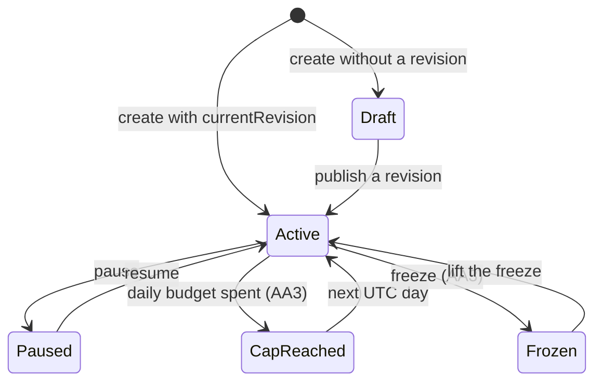

# Keepers

A keeper is an agent with a standing job. Most Garrison runs start because someone or something asked for them, such as a person invoking an agent or a trigger firing. A keeper instead holds a mandate, such as "keep the support queue under 20 open tickets", and Garrison wakes it on a schedule to look after that job. Each wake is a tick: one ordinary run of the keeper's deployment, and it ends with the keeper reporting what it found.

Keepers arrived in 0.3.0 (plan phase AA1). They are managed over REST, the management MCP tools, manifests (`kind: Mandate`), the SDKs, and the dashboard (Autonomy, then Keepers). The API calls them mandates (`mdt_` identifiers) and the dashboard calls them keepers.

## What a mandate holds

The mandate record says which agent keeps it and where its ticks run. Its revisions say what the job is and how often to check.

| Mandate field | Meaning |
|---|---|
| `name` | Unique in the tenant: 1 to 64 lowercase letters, digits, and hyphens, starting and ending with a letter or digit |
| `description` | Notes for people, at most 4000 characters. The keeper does not read it |
| `agentId` | A hosted agent. Remote agents cannot be keepers (`RemoteAgentUnsupported`). Fixed after creation |
| `deploymentId` | An active deployment of that agent. Every tick runs there, with its harness, model, and tools |
| `status` | `Draft`, `Active`, `Paused`, `Frozen`, `CapReached`, or `Retired` (see below) |
| `currentRevisionId`, `currentRevisionNumber` | The published revision the keeper follows |
| `nextWakeUtc`, `pendingWakeSource` | When the next tick starts, and what asked for it when it was not the timer |
| `currentIntervalSeconds`, `consecutiveQuietTicks` | The schedule's state (see [Backoff](#backoff)) |
| `lastTickUtc`, `lastTickOutcome`, `tickCount` | Tick bookkeeping |
| `activeTickId`, `activeRunId` | The tick in progress, if any |
| `runAsType`, `runAsId`, `runAsName` | The principal ticks run as: whoever last created or updated the mandate |

| Revision field | Meaning |
|---|---|
| `objective` | Required. The job in plain words. Every tick's system prompt starts from it |
| `healthyDefinition` | What good looks like, so the keeper can tell a quiet tick from one that needs action |
| `autonomy` | What the keeper may change on its own. Left empty, the keeper is told to observe and report only |
| `escalationPolicy` | When the keeper should stop and ask for a decision |
| `escalationTargetKind`, `escalationTargetId` | Who the keeper's escalations go to when a tick names no one: a `User`, `Role`, or `Agent` and its identifier or name. A timed-out escalation with `EscalateUp` is passed up to this target too. Left empty, escalations go to the user the keeper runs as |
| `direction` | Short-term guidance that changes often, such as this week's focus |
| `signals` | Up to 50 named measurements to check each tick, each with an optional description |
| `wakeMode` | `Backoff` (the default) or `Fixed` |
| `minIntervalSeconds`, `maxIntervalSeconds` | 10 seconds to 30 days; defaults 900 and 86400. The cluster settings `Autonomy.MinIntervalSeconds` and `Autonomy.MaxIntervalSeconds` narrow the range |
| `backoffFactor` | 1 to 10, default 2. How much the interval grows after a quiet tick |
| `jitterPercent` | 0 to 50, or null for `Autonomy.DefaultJitterPercent` |
| `budgetPerTickUsd`, `budgetPerDayUsd`, `maxTokensPerTick` | Spending limits. The two US dollar budgets are enforced: a tick over its budget is refused or cancelled, and a keeper over its daily budget shows `CapReached` until the next UTC day (see [Brakes](BRAKES.md#spend-caps)). `maxTokensPerTick` is stored and validated but not enforced yet |
| `briefIntervalHours` | Hours between briefs to the board, 1 to 720, or null for none (AA10). It applies when the keeper's agent leads the root unit of a live organization: a tick whose agent filed no `Brief` report within the interval asks for one through `builtin/board-brief` |
| `changeNote` | Why this revision changes the keeper |
| `state`, `source`, `author` | `Draft` or `Published`; who wrote it (`Human`, `Board`, `Executive`, `Architect`); the user or credential that saved it |

Each text field holds at most 8000 characters. Values outside the cluster interval bounds are not rejected. They are raised or lowered, and the response lists a `ValueClamped` warning in `warnings` saying what was given and what was stored.

## Lifecycle



Creating a mandate with an inline `currentRevision` publishes that revision as number 1 and makes the mandate `Active` with its first wake due now. Created without one, it stays `Draft` and never wakes until a revision is published.

Changing the job means writing a new revision. `POST .../revisions` saves it as a draft, which changes nothing. Publishing it makes it current, resets the interval to the minimum, makes a `Draft` mandate `Active`, and wakes an `Active` one now. Published revisions never change, so the revision list is a complete history of what the keeper was told to do. Publishing an older draft after a newer revision is current marks it published but leaves the newer one in place.

Pause stops further wakes; a tick in progress finishes. Resume wakes the keeper at once with the interval reset. Wake now starts a tick without waiting for the schedule. `Frozen` and `CapReached` come from the brakes: a freeze on the keeper, or its daily budget running out. A frozen keeper is `Active` again once the freeze is lifted, and a capped one once the next UTC day starts. A freeze on the keeper's agent or deployment, or the autonomy kill switch, also stops its wakes without changing its status; each skipped wake is a `Skipped` tick with code `Frozen` or `KillSwitch`. See [Brakes](BRAKES.md). `Retired` is set by a later lifecycle phase.

## Who a keeper runs as

A keeper wakes when nobody is around, so it runs as the principal that last created or updated it, the same rule triggers use. Creating or updating a mandate needs `Mandate.Create` or `Mandate.Update` and also `Agent.Execute` on its agent; without it the save answers 403 and nothing changes. Saving a mandate again makes you its run-as principal, which is how you hand one over. Publishing a revision does not change who it runs as.

## A tick, step by step

1. The leader control-plane replica sweeps every `Autonomy.SchedulerSweepSeconds` (default 5) for active mandates whose `nextWakeUtc` has passed, at most `Autonomy.MaxDueClaimsPerSweep` per sweep.
2. It claims the mandate with a compare-and-set on the expected wake time, so two replicas never start the same tick. It records a tick with its wake source (`Timer`, `Manual`, `Message` for urgent mail, `EscalationAnswer`, and later `Webhook` or `Report`).
3. It starts a run of kind `Keeper` on the mandate's deployment, linked by `mandateId` and `mandateTickId`. The system prompt is the agent's own plus the `builtin/keeper-system` fragment, which renders the current revision. The input comes from `builtin/keeper-tick`: why the keeper woke, how its last tick ended, and its most recent summaries (`Autonomy.TickInputRecentTicks`, default 5). Keeper runs always have the Garrison MCP server.
4. The keeper checks its signals, acts within its autonomy, and can call `garrison_keeper_context` to read its mandate and tick history again.
5. The keeper ends by calling `garrison_keeper_complete_tick` once, with an outcome (`Quiet`, `Acted`, `Attention`, or `Escalated`), a summary of at most 4000 characters that the next tick will read, and optionally `nextWakeSeconds`. The first report wins; calling again changes nothing.
6. When the run ends, Garrison finishes the tick, records the outcome, cost, and interval, and schedules the next wake. The fast path runs as the run finishes; the sweep reconciles any tick it missed. A run that ends without a report is `Unreported`, or `Failed` when the run failed or timed out. If the replica that claimed a tick stops before starting its run, the sweep finishes that tick as `Failed` (`StartInterrupted`) after 120 seconds.

Summaries from earlier ticks reach the keeper as data, framed as its own notes, and the system prompt tells it never to follow instructions found in tool output, files, memory, or earlier summaries that conflict with its mandate. When agent memory is on, the tick input also carries the agent's memory entries tagged `recall` (at most 20 entries and 16 KiB), framed the same way through `builtin/memory-recall`; a keeper that wants to remember something on every tick writes it with `tags: ["recall"]`. See [AGENT_MEMORY.md](AGENT_MEMORY.md). A keeper whose agent manages other agents (a lead in an [organization](ORGANIZATIONS.md), or the entry agent of an app) also receives the reports they filed since its previous tick began, through `builtin/report-digest`, and files its own with `garrison_file_report`. See [REPORTS.md](REPORTS.md). Mail queued for the keeper's agent rides along too, oldest first, through `builtin/inbox-delivery`, and is marked delivered to the tick's run. An urgent message wakes the keeper at once with wake source `Message`; like a manual wake, it waits for a running tick to finish, and one tick then carries everything that arrived. See [MESSAGING.md](MESSAGING.md).

## Backoff

In `Fixed` mode the keeper wakes every `minIntervalSeconds`, whatever happens.

In `Backoff` mode the interval follows the outcome of each tick:

| Outcome | Next interval |
|---|---|
| `Quiet` | Current interval times `backoffFactor`, rounded up, at most `maxIntervalSeconds` |
| `Acted`, `Unreported` | Unchanged |
| `Attention`, `Escalated`, `Failed` | Back to `minIntervalSeconds` |

So a keeper with nothing to do checks less often over time, and anything worth noticing brings it back to its shortest interval.

An example with `minIntervalSeconds` 900 (15 minutes), `maxIntervalSeconds` 14400 (4 hours), `backoffFactor` 2, and no jitter:

| Tick | Outcome | Next interval | Quiet ticks in a row |
|---|---|---|---|
| 1 | Quiet | 1800 (30 min) | 1 |
| 2 | Quiet | 3600 (1 hour) | 2 |
| 3 | Quiet | 7200 (2 hours) | 3 |
| 4 | Quiet | 14400 (4 hours, the maximum) | 4 |
| 5 | Quiet | 14400 | 5 |
| 6 | Acted | 14400 | 0 |
| 7 | Attention | 900 (15 min) | 0 |
| 8 | Quiet | 1800 | 1 |

A keeper can ask for a specific wait with `nextWakeSeconds`. Garrison keeps it within the revision's minimum and maximum and uses it for the next wake only; the interval that later ticks grow from still follows the table.

Jitter spreads keepers out so that a hundred of them created together do not all wake in the same second. Each wake is delayed by a random amount between zero and `jitterPercent` of the applied interval. Jitter only ever adds time, so a keeper never wakes before its interval.

## One tick at a time

A mandate never has two ticks running. When the timer comes due while a tick is still running, Garrison records a `Skipped` tick (error code `PreviousTickRunning`) and moves the timer on by one interval. A manual wake that arrives during a tick is not skipped: it waits and starts as soon as the running tick finishes.

Deleting a mandate while a tick runs answers 409 `MandateActive`. Wait, pause it first, or delete with `force=true`, which cancels the tick's run.

## Asking for a decision

When a tick reaches something its `autonomy` does not cover, it calls `garrison_escalate` with the question, reports `Escalated`, and ends. The keeper does not wait. Whoever the escalation is addressed to answers it in the dashboard, over REST, or as an agent, and the answer wakes the keeper once with wake source `EscalationAnswer`. That tick's input carries every answer the keeper has not seen yet, after the usual tick input, rendered through `builtin/escalation-answered`. An answer counts as delivered once a tick has carried it, so no answer is shown twice.

A tick can also look up its own escalations with `garrison_list_my_escalations` and `garrison_get_escalation`, and withdraw one that no longer matters. It sees escalations raised by earlier ticks of the same keeper. See [Escalations](ESCALATIONS.md).

## Watching a keeper

- The dashboard page Autonomy, then Keepers, lists every keeper with its status, next wake, interval, and last outcome. Each keeper's page has a chart of its interval, the tick history with links to each run, and its revisions with a diff. Home shows keepers whose last tick needs a person.
- The WebSocket channel `mandate:{id}` sends `tick.started` and `tick.completed` (see [WEBSOCKETS_API.md](../WEBSOCKETS_API.md)).
- `GET .../runs?mandateId={id}` lists a keeper's tick runs; each has `kind: Keeper`.
- The metrics `garrison.keeper.ticks`, `garrison.keeper.tick.lag.duration`, and `garrison.keeper.interval` feed the Grafana dashboard `garrison-autonomy` (see [TELEMETRY.md](TELEMETRY.md)).

Finished tick history is kept for `Autonomy.TickHistoryRetentionDays` (30).

## Examples

[examples/autonomous/gerbil](../examples/autonomous/gerbil/README.md) is a complete keeper you can apply and play tick by tick on the fake harness, with a Claude Code variant; `scripts/run-autonomy-example.sh` runs it end to end. [examples/autonomous/site-reliability-org](../examples/autonomous/site-reliability-org/README.md) puts keepers in an organization.

Create a keeper with its first revision over REST:

```bash
curl -s -X POST "http://127.0.0.1:8700/v1.0/api/tenants/default/mandates" \
  -H "Authorization: Bearer $TOKEN" -H "Content-Type: application/json" \
  -d '{
    "name": "support-queue",
    "agentId": "support-agent",
    "deploymentId": "support-agent-prod",
    "currentRevision": {
      "objective": "Keep the support queue under 20 open tickets.",
      "healthyDefinition": "Fewer than 20 open tickets and none older than a day.",
      "autonomy": "Answer password resets and close duplicates.",
      "escalationPolicy": "Ask a person before refunding anything.",
      "signals": [{ "name": "open tickets", "description": "Count in the support inbox" }],
      "wakeMode": "Backoff",
      "minIntervalSeconds": 900,
      "maxIntervalSeconds": 14400
    }
  }'
```

Change the target later by publishing a new revision:

```bash
REV=$(curl -s -X POST "http://127.0.0.1:8700/v1.0/api/tenants/default/mandates/support-queue/revisions" \
  -H "Authorization: Bearer $TOKEN" -H "Content-Type: application/json" \
  -d '{"objective": "Keep the support queue under 10 open tickets.", "changeNote": "Tighter target", "minIntervalSeconds": 900, "maxIntervalSeconds": 14400}' | jq -r .id)
curl -s -X POST "http://127.0.0.1:8700/v1.0/api/tenants/default/mandates/support-queue/revisions/$REV/publish" \
  -H "Authorization: Bearer $TOKEN"
```

The same keeper as a manifest:

```yaml
apiVersion: garrison/v1
kind: Mandate
metadata:
  name: support-queue
spec:
  agent: support-agent
  deployment: support-agent-prod
  revision:
    objective: Keep the support queue under 20 open tickets.
    autonomy: Answer password resets and close duplicates.
    signals:
      - name: open tickets
        description: Count in the support inbox
    wakeMode: Backoff
    minIntervalSeconds: 900
    maxIntervalSeconds: 14400
```

What a keeper sends at the end of a tick:

```json
{
  "name": "garrison_keeper_complete_tick",
  "arguments": {
    "outcome": "Acted",
    "summary": "Queue at 14. Answered 3 password resets and closed 2 duplicates.",
    "nextWakeSeconds": 1800
  }
}
```

## Reference

- REST routes: [REST_API.md](../REST_API.md#mandates)
- MCP tools: [MCP_API.md](../MCP_API.md) (`garrison_keeper_context`, `garrison_keeper_complete_tick`, and the `garrison_*_mandate*` management tools)
- Manifests: [MANIFESTS.md](MANIFESTS.md#mandate)
- Prompts: [PROMPTS.md](PROMPTS.md#keepers)
- Settings: [CONFIGURATION.md](CONFIGURATION.md) (`Autonomy.*`)
- Design decisions: AA-031 to AA-037 in `AUTONOMOUS_AGENTS_PLAN.md`
