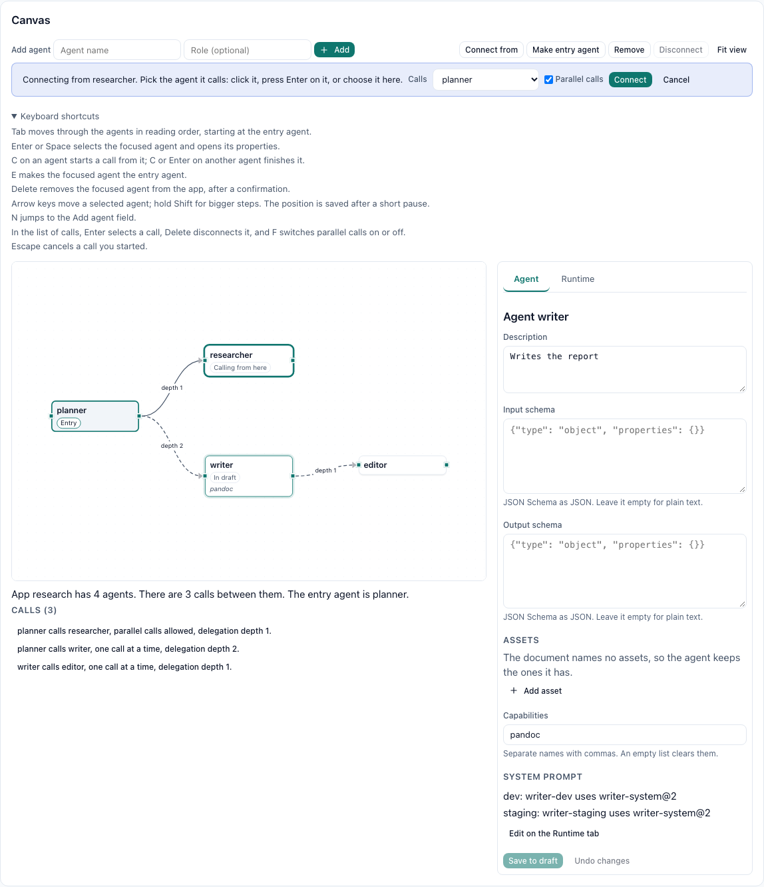

# Agent Studio

The studio is where agents and apps get designed before anything changes in live configuration. Work happens in a **draft**: a set of manifest documents, one per resource, that a person or the agent architect edits. When the draft looks right, someone asks for it to be applied. That creates an approval, and a person with the right permissions decides it. Only then does the draft touch live configuration.

```
 person or architect          person who may apply manifests
         |                                  |
   edit draft items  -->  request-apply --> DraftApply approval --> apply (one manifest apply)
   graph operations         (validates)        allow / deny
   diff, validate
```

## Drafts

A draft belongs to a tenant and to the person who started it (for an architect run, the person the run works for). It has a title, an optional target app, a version number, a status, its items, and a canvas layout.

| Status | Meaning |
|---|---|
| `Open` | Editable |
| `PendingApproval` | Waiting for a decision on its `DraftApply` approval. Frozen |
| `Applied` | Applied; `manifestApplyId` links to the manifest apply record |
| `Discarded` | Discarded |

Each item is one manifest document, keyed by kind and name, with an operation:

- `Upsert` creates or updates the resource. The document is plain manifest YAML ([MANIFESTS.md](MANIFESTS.md)) and its kind and name must match the item's.
- `Delete` deletes the resource when the draft is applied. Drafts can delete `Agent`, `Deployment`, `Pipeline`, and `AgenticApp`.

Drafts hold `PromptTemplate`, `HarnessProfile`, `McpServer`, `WorkspaceTemplate`, `AgentAsset`, `Agent`, `Deployment`, `Pipeline`, `AgenticApp`, `Trigger`, and `NotificationEndpoint` documents. They never hold secrets: a document refers to a secret by name, and the secret itself is managed separately.

Item document text is stored as written. It is one of the few unmanaged text columns in Garrison, because a draft can hold a document that does not validate yet.

### Versions

Every change to a draft (an item, a graph operation, the layout, a status change) raises its version by one. Each change names the version the caller read. If the draft moved on in the meantime, the change fails with 409 `DraftVersionConflict`, whose message names the draft's current version, and changes nothing; read the draft again and retry. Two editors, or a person and the architect, can therefore work on one draft without overwriting each other.

### Starting from an app

`POST .../studio/drafts` with `fromApp` exports the app with everything it references (members, their deployments, prompt templates, assets, and so on) and makes one item per document. Each item records a hash of the live document it started from. That hash is how the studio notices when live configuration changes under a draft.

## Diff and validation

`GET .../diff` compares each item with live configuration:

| `change` | Meaning |
|---|---|
| `Create` | The resource does not exist yet |
| `Update` | It exists and differs; `changes` lists the fields |
| `Delete` | The draft deletes it |
| `Unchanged` | Applying changes nothing |
| `Failed` | The document does not validate; `message` and `errorCode` say why |

An item is `stale` when the live resource changed after the draft was based on it. `POST .../validate` runs the same comparison. Both are a manifest dry run of the draft's documents, so they give the same per-document results as `POST .../manifests/apply?dryRun=true`. `valid` is true when nothing failed and nothing is stale.

## Applying a draft

`POST .../request-apply` with the version you read:

1. validates the draft and refuses with 400 `DraftStale`, `DraftInvalid`, or `DraftEmpty`;
2. creates an approval of kind `DraftApply`. Its summary counts the creates, updates, and deletes, and its `input` holds the full diff as a JSON object;
3. moves the draft to `PendingApproval`.

Nothing changes in live configuration yet. The approval appears with the other approvals ([REST_API.md](../REST_API.md#approvals)) and is decided with the same `POST .../approvals/{id}/decide`:

- **Allow** checks that the decider holds Create on `Manifest` and Delete on each kind the draft deletes (403 `ApproverLacksPermission` otherwise). It then validates again. If live configuration moved since the request, the approval is denied with 409 `DraftStale`, and the draft returns to `Open` for the author to rebase. Otherwise the documents apply as one manifest apply, deletes run, and the draft becomes `Applied`. Applying deploys to `dev`: each agent the draft changed gets a new published revision, and its `dev` deployments that are pinned to a revision move to it. Other environments change only through promotion ([REVISIONS.md](REVISIONS.md)), so a draft never reaches staging or production directly.
- **Deny** returns the draft to `Open`.
- An approval that expires (after 7 days) or is cancelled also returns the draft to `Open`. Discarding a pending draft cancels its approval.

A run can never decide a draft approval: 403, whatever its permissions.

## The graph

`GET .../graph` draws a draft's apps: a node per app and per agent (agents the draft holds, plus members its apps refer to), each app's call edges, the apps each agent belongs to or is the entry of, the capabilities each drafted agent names, and canvas positions. Each edge carries its fan-out flag and the delegation depth it needs: one plus the longest chain of calls below the called member.

`POST .../graph-operations` changes the graph with one operation at a time:

| `operation` | Fields | Effect |
|---|---|---|
| `AddMember` | `agent`, optional `role` | Adds a member; the first member becomes the entry agent |
| `RemoveMember` | `agent` | Removes the member and every edge touching it |
| `Connect` | `from`, `to`, optional `fanOut` | Adds or updates an edge |
| `Disconnect` | `from`, `to` | Removes an edge |
| `SetEntry` | `agent` | Makes a member the entry agent |
| `MoveNode` | `nodeKey`, `x`, `y` | Places a node on the canvas (layout only) |

`app` names the app and defaults to the draft's target app. An operation on an app the draft does not hold yet starts from the live app, or from a new app when none exists. Member and edge operations rewrite the draft's `AgenticApp` item, so the graph and the item text never disagree.

## Canvas

The Graph tab of a draft in the dashboard is a canvas you edit directly. It shows one app at a time (a picker appears when the draft holds more than one): agents as boxes, calls as arrows labelled with their delegation depth, a solid arrow for a call that may fan out and a dashed one for a call made one at a time. The entry agent carries an Entry tag, agents whose document the draft holds say In draft, and the capabilities a drafted agent names sit in italics under its name. Every marker is a word, so nothing depends on color.


Nothing on the canvas is a local sketch. Each change goes to the server as soon as you make it, either as one of the graph operations above or as a save of a draft item, with the version you read. Drag from the small handle on an agent's right edge to another agent and you get a `Connect`. The toolbar adds an agent (type a name, or pick one of the tenant's agents or the draft's), starts a connection from the selected agent, makes it the entry agent, removes it from the app after a confirmation, and disconnects the selected call. Dragging an agent moves it, and the position is saved with `MoveNode` once you stop for a moment, so a long drag is one request rather than fifty. Positions live in the draft's layout, which is why they are still there after a reload or on someone else's screen.

Changes go out one at a time, in the order you made them, and each one carries the newest version the canvas knows about. That keeps a quick sequence (add two agents, connect them, nudge one into place) from tripping over its own version numbers.

### Keyboard

Everything the mouse does on the canvas also works from the keyboard. Agents are focusable in reading order: the entry agent first, then by how far down the call chain each one sits. The shortcuts are listed under the toolbar as well.

| Key | Where | What it does |
|---|---|---|
| Enter or Space | an agent | Selects it and opens its properties |
| C | an agent | Starts a call from it; C or Enter on a second agent finishes the call |
| E | an agent | Makes it the entry agent |
| Delete | an agent | Removes it from the app, after a confirmation |
| Arrow keys | a selected agent | Moves it 5 pixels, or 20 with Shift; saved after a short pause |
| N | anywhere on the canvas | Jumps to the Add agent field, where Enter adds the agent |
| Delete, F | a call in the list | Disconnects the call, or switches parallel calls on and off |
| Escape | while connecting | Cancels the call you started |

Calls are reached through the outline under the drawing rather than on the drawing itself. React Flow puts arrows ahead of boxes in the page, so tabbing through arrows on the canvas would visit every call before the first agent. The outline instead gives each call a button with the call in words ("planner calls writer, one call at a time, delegation depth 2."), after the agents in tab order. Starting a connection also opens a bar that names the caller and offers the callee as a list with a Parallel calls box, which is a second way to finish a connection without a pointer.



The outline doubles as the canvas's description for screen readers. It starts with the counts and the entry agent ("App research has 4 agents. There are 3 calls between them. The entry agent is planner.") and the drawing points at it with `aria-describedby`. Each change you make is announced in a polite live region, for example "planner now calls editor."

### Property panels

The panel beside the drawing edits whatever is selected. With nothing selected it shows the app: the entry agent (a `SetEntry`, applied at once), and the description, sign-in mode, anonymous use, and branding, which rewrite the draft's `AgenticApp` item when you choose Save to draft. A selected call shows its caller and callee, the Parallel calls switch (a `Connect` with the new `fanOut`), and its delegation depth. Depth is read-only on purpose, because the server derives it from the graph: one plus the longest chain of calls below the callee.

A selected agent has two tabs. Agent edits its own document: description, input and output schema as JSON, asset pins, and capabilities. Saving rewrites only the keys the panel owns in the `Agent` item and leaves the rest of the YAML alone, so a field the architect added by hand survives. If the draft does not hold the agent yet, the panel offers to bring it in from its live document first.

Runtime edits the agent's `Deployment` items, one environment at a time: model, effort, time limit, maximum turns, budget, the System prompt template with an optional pinned version (written as `prompts.System: name@version`), and the approval switch, default action, and rules. A save there touches exactly one deployment item, so setting a ten minute timeout in staging leaves dev and prod as they were. Live deployments of the agent that the draft does not hold are listed underneath with a button that exports one into the draft.


The System prompt is edited on Runtime rather than Agent because that is where Garrison keeps it. An `Agent` manifest has no key for prompt pins; each deployment names its own prompts, which is also what lets staging try a new prompt while prod keeps the old one. The Agent tab lists the System prompt each environment uses and links to Runtime.

Saved edits appear in Diff and apply like any other item change. Mistakes show where they happen: a schema that is not JSON is caught in the browser before anything is sent, a field error from the server shows under its field with its field code translated, and when validation fails for the item (an `InvalidJsonSchema` from the dry run, say) the panel shows the server's message next to the field it concerns.

### Live updates and conflicts

The canvas follows the draft's `studio-draft:{id}` channel, or polls every five seconds when the channel is not available. When the architect connects two agents through its graph tools, or a colleague moves a box, the canvas redraws without a reload, and the banner above the tabs says what moved.

If your change reaches the server after someone else's, the server refuses it with `DraftVersionConflict`. The canvas then reads the draft again and shows a notice naming what changed in between: items added, edited, or removed, and the new version. Your edit is not thrown away. A property panel keeps every field you typed, and the notice says when the very item you were editing changed too, so you can compare before saving again. A refused graph operation gets a Try again button that sends it on the new version. A refused move is retried once on its own, without a notice, because it only touches the layout.

The screenshots on this page come from the dashboard's mocked browser tests with the fake-harness example draft. Regenerate them with `GARRISON_DOCS_SCREENSHOTS=1 npx playwright test tests/e2e/docsScreenshots.spec.js` in `dashboard/`.

## Playground

The playground runs an agent's draft revision before anything is published. Each run goes to a temporary copy of one of the agent's deployments (its `dev` deployment, or the first one), named `playground-{agent}` and kept in the reserved `draft` environment, pinned to the revision being tried. Playground runs have kind `Playground`. They keep conversations and file spaces like any run, but they are left out of capability hints, and no app can select the `draft` environment, so end users never reach them.

- `POST .../agents/{agentId}/playground/invoke` with `{input, agentRevisionId?, sourceDeploymentId?, conversationId?, wait, waitSeconds}` runs the given revision, by default the agent's open draft revision. Needs Execute on the agent.
- `POST .../studio/drafts/{id}/playground/invoke` with `{input, agent?, conversationId?}` first writes the draft's document for that agent (default: the target app's entry agent) as the agent's draft revision, then runs it. Live configuration does not change. Needs Update on `StudioDraft` and on `AgentRevision`. An agent the draft creates must be applied before it can be tried (400 `AgentNotLive`).
- MCP: `garrison_studio_playground_invoke` with `draftId`, `input`, and optional `agent`, `conversationId`, `waitSeconds`, also available to the architect.

Users cannot create deployments in the `draft` environment (400 `ReservedEnvironment`). Deleting the agent deletes its playground copy.

## Delegated management

The agent architect builds drafts by calling studio tools from inside a run. Runs normally cannot touch configuration. A deployment can grant its runs draft access with `managementAccess: Drafts`:

```yaml
kind: Deployment
metadata:
  name: architect
spec:
  agent: agent-architect
  harnessProfile: claude-code
  managementAccess: Drafts
```

The run token of such a deployment may:

- create, read, and edit studio drafts, try them in the playground (which writes agent draft revisions, never published ones), and request their apply;
- read design configuration: deployments, harness profiles, prompt templates, MCP servers, workspace templates, agent revisions, agent assets, capabilities, apps, pipelines, and triggers.

Every permission is also checked against the person who started the run, so the architect can never do more than that person. It sees and edits only that person's drafts. It can never apply a draft, decide an approval, delete live resources, or read secret values. The grant ends when the run ends, like every run token.

## The agent architect

Every tenant has a protected agent named `agent-architect`. It designs agents and apps with a person, in a draft, using the studio tools above. Its published revision pins the skill asset `agent-architect-skills`, which teaches it manifest authoring and Garrison conventions. It cannot be edited or deleted. To change how it behaves, give its deployment a different prompt. [ARCHITECT.md](ARCHITECT.md) covers the architect in depth: its prompts, cloning and selection, the next-turn rule, pins, and how to test it on the fake harness.

It has no deployment until you create an **architect**, which is a deployment of `agent-architect` with a harness, a model, and an architect prompt:

```bash
curl -s -X POST $B/studio/architects -H "Authorization: Bearer $TOKEN" -H "Content-Type: application/json" \
  -d '{"name":"architect","harnessProfileId":"hrn_builtin_claude_code","architectPromptTemplateId":"builtin/agent-architect-guided"}'
```

An architect always gets `managementAccess: Drafts`, and binds `builtin/agent-architect` unless you choose another architect prompt. Architects belong to the tenant, not to a draft: any draft can use any architect, and a tenant can keep several (a fast one, a careful one, one on a different harness). In the dashboard they live on Agents > Architects, and a draft's Architect tab picks which one to talk to. Talk to it like any agent, for example in a conversation. It works only on the drafts of the person talking to it, within that person's permissions.

## Routes

All paths are under `/v1.0/api/tenants/{tenantId}/studio/drafts`:

| Method and path suffix | Permission | Result |
|---|---|---|
| `GET` | Read on `StudioDraft` | `EnumerationResult<StudioDraft>`; `mine=true` for your own, `status` (`Open`, `PendingApproval`, `Applied`, `Discarded`) to filter |
| `POST` | Create on `StudioDraft` (and Read on `AgenticApp` with `fromApp`) | `StudioDraft`, 201 |
| `GET /{id}` | Read on `StudioDraft` | `StudioDraft` |
| `DELETE /{id}` | Delete on `StudioDraft` | 204 |
| `PUT /{id}/items/{kind}/{name}` | Update on `StudioDraft` | `StudioDraft`. Body `{version, operation, document}` |
| `DELETE /{id}/items/{kind}/{name}?version=` | Update on `StudioDraft` | `StudioDraft` |
| `GET /{id}/diff`, `POST /{id}/validate` | Read on `StudioDraft` | `StudioDraftDiff` |
| `POST /{id}/request-apply` | Update on `StudioDraft` | `Approval`, 201. Body `{version}` |
| `GET /{id}/graph` | Read on `StudioDraft` | `StudioGraph` |
| `POST /{id}/graph-operations` | Update on `StudioDraft` | `StudioGraph` |

Architects and architect prompts, under `/v1.0/api/tenants/{tenantId}/studio`. `{deploymentId}` takes the architect's deployment ID or name:

| Method and path | Permission | Result |
|---|---|---|
| `GET /architects` | Read on `Deployment` | `EnumerationResult<Architect>`; `maxResults` (1 to 1000, default 25), `skip`, `ordering`, `search` (part of a name), `activeOnly` |
| `POST /architects` | Create on `Deployment` | `Architect`, 201. Body `ArchitectRequest`; 400 `ValidationFailed`, `InvalidArchitectPrompt`; 409 `NameConflict`, `ArchitectAgentMissing` |
| `GET /architects/{deploymentId}` | Read on `Deployment` | `Architect`; 404 when the deployment is not an architect |
| `PUT /architects/{deploymentId}` | Update on `Deployment` | `Architect`. Body `ArchitectRequest`; a null `architectPromptTemplateId` keeps the current prompt |
| `DELETE /architects/{deploymentId}` | Delete on `Deployment` | 204; drafts are kept |
| `GET /architect-prompts` | Read on `PromptTemplate` | `EnumerationResult<ArchitectPromptEntry>`; `maxResults`, `skip`, `search`. The order is fixed: built-ins, clones, other `System` templates |
| `GET /architects/{deploymentId}/prompt` | Read on `Deployment` | `ArchitectPromptSelection` |
| `PUT /architects/{deploymentId}/prompt` | Update on `Deployment` | `ArchitectPromptSelection`; 400 `NotAnArchitectDeployment`, `InvalidArchitectPrompt` |

Errors: 400 `ValidationFailed` with codes `UnsupportedKind`, `InvalidDocument`, `DocumentMismatch`, `DeleteNotSupported`, `NotAMember`, `SelfEdge`, `NoSuchEdge`, `AppDeleted`, and 400 `DraftStale`, `DraftInvalid`, `DraftEmpty` on request-apply; 409 `DraftVersionConflict`, `DraftNotOpen`; on decide, 403 `ApproverLacksPermission`, 409 `DraftStale`, `DraftInvalid`.

The MCP tools are in [MCP_API.md](../MCP_API.md#studio-drafts).
