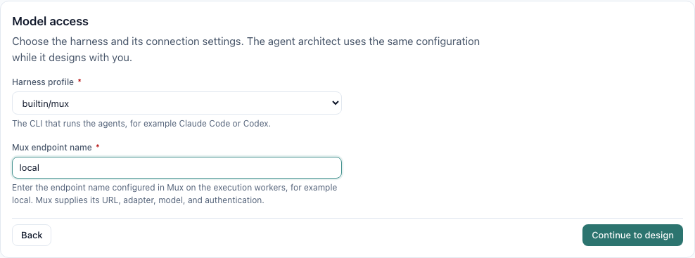

# Harness setup audit

The wizard follows the execution profile rather than treating every harness as an HTTP client. This audit covers the profiles shipped with Garrison v0.2.0. Product and harness versions are unchanged.

| Profile | Execution interface | Wizard inputs and authentication |
| --- | --- | --- |
| Mux | `mux --print --config-dir <private-run-config> -e <name>` | Only the configured endpoint name. The worker's Mux endpoint supplies its model, adapter, URL, and authentication. No wizard secret or model override. |
| Claude Code | `claude -p --output-format stream-json` | Optional model override; AnthropicApiKey or ClaudeCodeOAuthToken for the isolated built-in profile. |
| Codex exec | `codex exec --json` | Optional model override; OpenAiApiKey or CodexAuthJson. |
| Codex app-server | JSON-RPC app-server delivery | Same model and credential options as Codex; the worker uses app-server rather than exec. |
| Gemini CLI | `gemini -p ... -o stream-json` | Optional model override; GeminiApiKey for the built-in profile's isolated home. |
| Pi | `pi --mode json` | CLI model identifier, usually provider/model; optionally bind a supported secret if that provider needs it. Other provider/auth configurations require a suitable profile. |
| OpenCode | `opencode run --format json` | provider/model identifier; free or configured unauthenticated providers do not universally require a saved key. Bind a compatible credential for a provider that requires one. |
| Provider API | `garrison-provider-api --config <private-file>` | OpenAI-compatible HTTP URL and model are required. OpenAiApiKey, or explicit anonymous access. Other adapters are not currently supported by this runner. |
| Generic / fake | Profile-defined executable / deterministic test process | No inferred wizard credential requirement. Custom profiles define any additional bindings they need. |

Pi and OpenCode are optional in the worker image. Select workers that have the chosen harness installed. Their private configurations do not automatically inherit interactive host logins. Choosing no saved key does not make a paid provider anonymous; it is valid only with a provider/profile that needs no such credential.

The Mux contract was checked against `--help` from the actual bundled worker image (Mux 1.3.0), the installed Mux CLI, and Mux's configuration loader. The bundled CLI explicitly describes `--endpoint` as a named endpoint from the active `endpoints.json`. Pi and OpenCode were checked against their installed CLI help, the pinned profile arguments, and their primary documentation: [Pi](https://github.com/earendil-works/pi), [OpenCode model selection](https://opencode.ai/v2/docs/models/), and [OpenCode providers](https://docs.opencode.ai/docs/providers/). Claude/Codex/Gemini profile compilation remains covered by the compiler golden cases.

Regression checks cover named-endpoint compilation without a generated endpoint, worker-side selection and credential isolation, missing-name errors, every built-in wizard harness category, and the existing Studio/architect forms. These are configuration, compiler, worker, and browser checks; they do not make billable live model requests.
